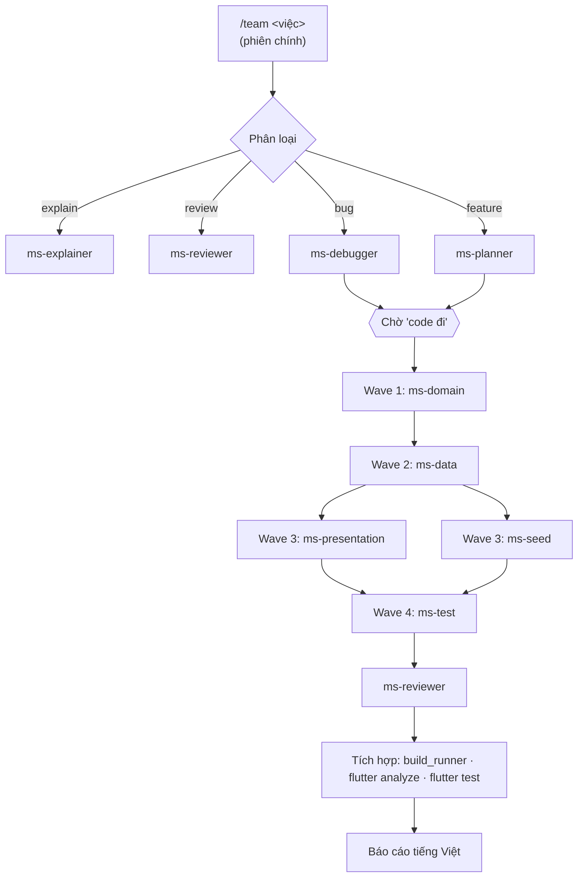

# /team - Hướng dẫn sử dụng

`/team <việc>` là lệnh điều phối chạy ở phiên chính. Nó phân loại việc của bạn, giao cho các
subagent `ms-*` trong `.claude/agents/`, chờ bạn duyệt kế hoạch rồi mới sửa code, cuối cùng chạy
build_runner / `flutter analyze` / `flutter test` và báo cáo bằng tiếng Việt.

> Claude Code không cho subagent gọi subagent khác → mọi việc điều phối nằm ở skill `/team`,
> các agent chỉ làm phần việc của mình và trả kết quả về.

## Sơ đồ cây



Bản ASCII:

```
/team <việc>
├── explain ──► ms-explainer ──────────────────────────────► trả lời
├── review  ──► ms-reviewer ───────────────────────────────► báo cáo phát hiện
├── bug     ──► ms-debugger ─┐
└── feature ──► ms-planner ──┴─► [chờ "code đi"]
                                  ├─ wave 1: ms-domain
                                  ├─ wave 2: ms-data
                                  ├─ wave 3: ms-presentation ∥ ms-seed
                                  ├─ wave 4: ms-test
                                  ├─ ms-reviewer
                                  └─ tích hợp ─► báo cáo
```

## Loại việc → chuỗi agent

| Loại | Chuỗi agent | Có sửa file? |
|---|---|---|
| `explain` | `ms-explainer` | Không |
| `review` | `ms-reviewer` | Không |
| `bug` | `ms-debugger` → ⏸ "code đi" → agent code theo lớp liên quan → `ms-reviewer` → tích hợp | Có, sau khi duyệt |
| `feature` | `ms-planner` → ⏸ "code đi" → `ms-domain` → `ms-data` → (`ms-presentation` ∥ `ms-seed`) → `ms-test` → `ms-reviewer` → tích hợp | Có, sau khi duyệt |

Wave nào không có việc thì bỏ qua. Trong một wave có thể chạy nhiều `ms-presentation` song song
nếu sửa các feature khác nhau (vd một cho `features/warehouse`, một cho `features/orders`).

## Thư mục → agent sở hữu

| Thư mục | Agent |
|---|---|
| `lib/core/domain/**`, `lib/core/enum/**`, `lib/core/error/**` | `ms-domain` |
| `lib/core/data/**`, `lib/core/{cache,sync,network,parse,services,config}/**`, `lib/core/di/injector.dart` | `ms-data` |
| `lib/features/**`, `lib/core/{router,theme,utils}/**`, `lib/main.dart` | `ms-presentation` |
| `scripts/seed/**` | `ms-seed` |
| `test/**` | `ms-test` |
| `injector.config.dart`, `*.freezed.dart`, barrel `presentation.dart` | Không ai - sinh bằng build_runner |
| `android/ ios/ … `, `.env*`, `pubspec.*` | Ngoài phạm vi - hỏi bạn |

Agent chỉ đọc: `ms-planner`, `ms-debugger`, `ms-reviewer`, `ms-explainer`.

## Ví dụ

```text
# feature
/team thêm lọc đơn hàng theo khoảng ngày trên tab Đơn hàng

# bug
/team thêm hàng xong quay lại tab Kho vẫn hiện số lượng cũ

# review
/team review thay đổi trên dev-kho so với dev

# explain
/team giải thích luồng đổi trạng thái đơn và trừ/hoàn tồn kho
```

## Lưu ý
- `feature` và `bug` luôn dừng ở bước trình kế hoạch. Gõ **`code đi`** để bắt đầu sửa; góp ý thêm
  thì `/team` sẽ chỉnh kế hoạch và hỏi lại.
- `/team` không commit, không push, không chạy seed lên Back4App - các bước đó được liệt kê trong
  mục "Việc bạn cần làm thủ công" ở báo cáo cuối.
- Lỗi analyzer chặn build ở bước tích hợp được sửa bằng giá trị mặc định an toàn + `// TODO(team)`.
