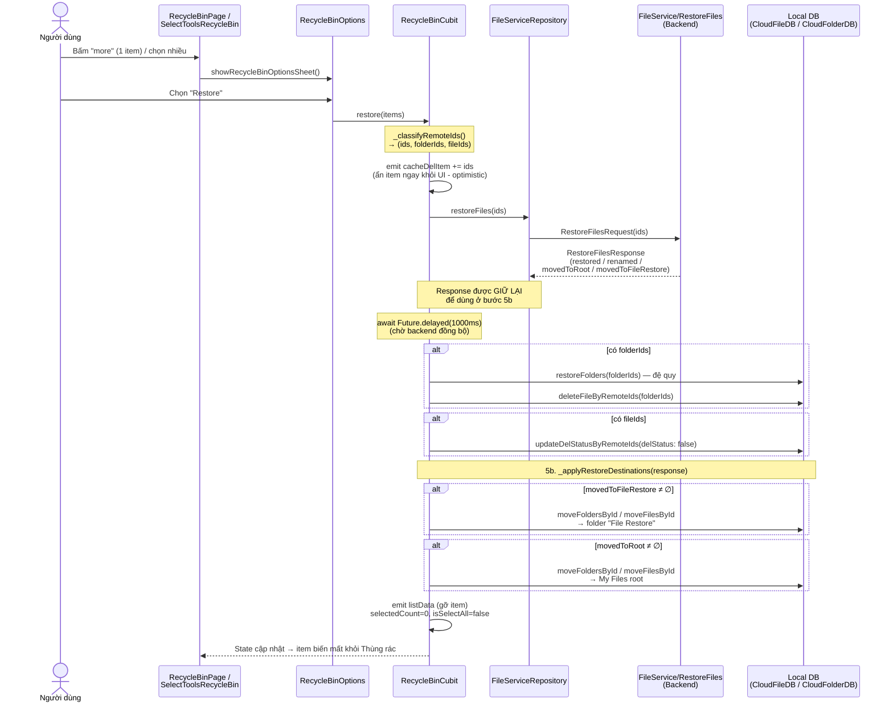
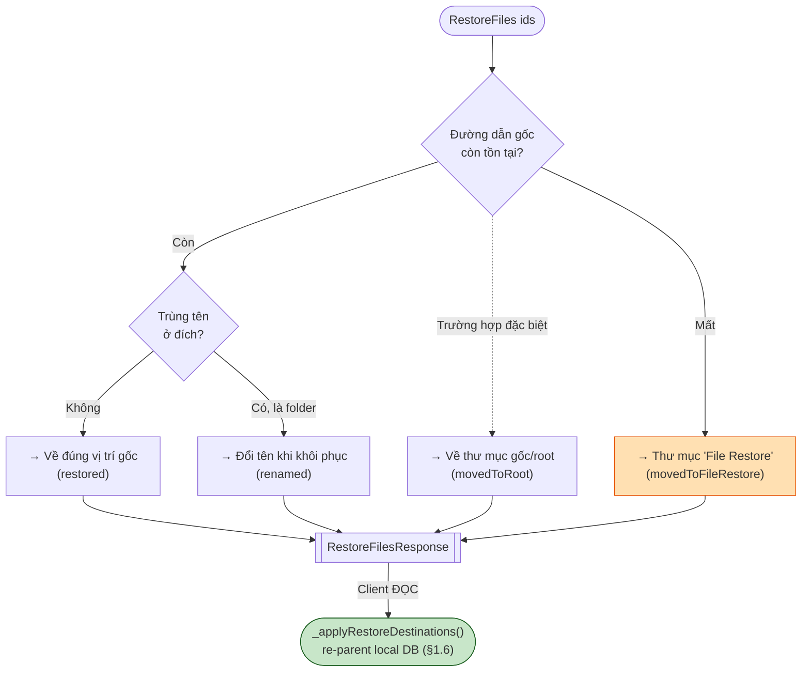
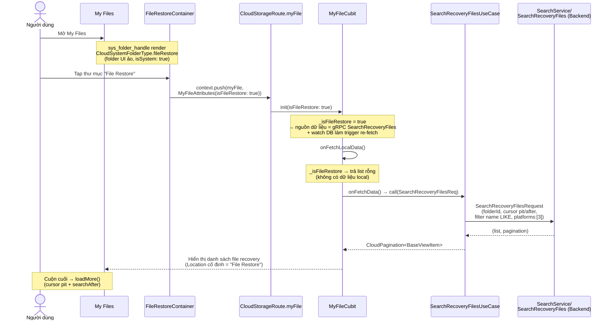
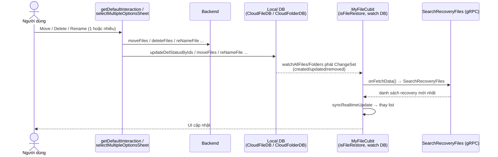

# File Restore (Khôi phục file) — Documentation

**Module:** `lib/features/cloud_storage/_new_cloud_storage/`
**Branch:** `felix/recycle_bin`

## Tổng quan

Tài liệu này mô tả toàn bộ cơ chế **khôi phục (restore)** trong Cloud Drive. Cần phân biệt
**ba khái niệm "restore" khác nhau nhưng liên quan**:

| # | Khái niệm | Ý nghĩa | gRPC dùng |
|---|-----------|---------|-----------|
| 1 | **Restore từ Recycle Bin** | Người dùng chọn file/folder trong Thùng rác → bấm "Khôi phục" về vị trí cũ | `FileService/RestoreFiles` |
| 2 | **Restore item trong 1 folder đã xóa** | Mở 1 folder đang nằm trong Thùng rác → khôi phục từng item con | `FileService/RestoreItemsInTrashFolder` |
| 3 | **Thư mục "File Restore" (fallback)** | Thư mục hệ thống trong My Files — nơi **backend** đưa file vào khi đường dẫn gốc không còn tồn tại | `SearchService/SearchRecoveryFiles` (đọc danh sách) |

> **Khái niệm cốt lõi:** Khi khôi phục, hệ thống cố đưa file/folder về **đường dẫn gốc**. Nếu
> đường dẫn gốc không còn (cha đã bị xóa vĩnh viễn), **backend** tự động chuyển file sang thư mục
> **"My File > File Restore"** thay vì báo lỗi. Quyết định fallback vẫn do **server**; client **đọc
> `RestoreFilesResponse`** để biết server đã chọn đích nào rồi cập nhật local DB cho khớp.

> **Thay đổi so với bản trước (2026-07-30):** thư mục "File Restore" giờ là **row thật trong
> ObjectBox** (không còn là folder UI ảo), và `RecycleBinCubit.restore()` **có đọc**
> `RestoreFilesResponse` để re-parent item theo `movedToFileRestore` / `movedToRoot`. Nguồn hiển thị
> danh sách **vẫn là** gRPC `SearchRecoveryFiles` — xem §3 và §9.

---

## Cấu trúc file liên quan

```
_new_cloud_storage/
├── pages/recycle_bin/
│   ├── recycle_bin_page.dart                    # UI Thùng rác, trigger restore
│   ├── cubit/recycle_bin_cubit.dart             # restore() + _applyRestoreDestinations()
│   │                                            #   _resolveFileRestoreFolder / _reparentByRemoteIds
│   └── widgets/
│       ├── select_mode_tools_bar.dart           # SelectToolsRecycleBin — restore nhiều item
│       └── recycle_bin_rules_sheet.dart         # Sheet "Recycle Bin Rules" (thông báo quy tắc restore)
│
├── pages/view_folder/
│   ├── cubit/view_folder_cubit.dart             # restore() item trong folder đã xóa (L108-113)
│   └── view_folder_page.dart                    # UI trigger
│
├── pages/my_file/
│   ├── cubit/my_file_cubit.dart                 # chế độ _isFileRestore (đọc SearchRecoveryFiles)
│   ├── my_file_page.dart                        # MyFileAttributes.isFileRestore + initialFolder
│   │                                            #   (initState phải forward cờ ở nhánh initialFolder)
│   └── widgets/my_file_body_view.dart           # dòng "Location" cố định = "File Restore"
│
├── shared/
│   ├── widgets/sys_folders/
│   │   ├── file_restore.dart                    # FileRestoreContainer — tile + mở row DB thật
│   │   └── sys_folder_handle.dart               # render folder này trong My Files
│   ├── enum/sys_folder_enum.dart                # CloudSystemFolderType.fileRestore
│   │                                            # + NewSystemFolder.fileRestore (key + convertToLang)
│   └── widgets/bottom_sheet/recycle_bin_options/
│       └── recycle_bin_options.dart             # Sheet 2 nút Delete / Restore
│
├── domain/use_cases/recycle_bin/
│   ├── trash_folder_items_use_case.dart         # RestoreItemsInTrashFolderUseCase
│   └── search_recovery_files_use_case.dart      # SearchRecoveryFilesUseCase (đọc File Restore)
│
└── data/
    ├── _grpc/repositories/file_service_repository(_impl).dart   # restoreFiles / restoreItemsInTrashFolder
    ├── _grpc/repositories/search_service_repository_impl.dart   # _discoverFileRestoreRemoteId()
    ├── _grpc/proto_generated/file.pb.dart                       # RestoreFilesRequest/Response
    ├── db/cloud_folder_db.dart                                  # getFileRestoreFolder /
    │                                                            #   ensureFileRestoreFolderExists /
    │                                                            #   updateFileRestoreRemoteId
    └── repository/my_file/cloud_my_file_repository_impl.dart    # restoreFolders() — cập nhật local DB
                                                                 # + ẩn row File Restore khỏi list thường
```

---

## 1. Luồng "Restore từ Recycle Bin" (luồng chính)

### 1.1. Trigger từ UI

Có 2 điểm vào, cả hai đều mở bottom sheet `RecycleBinOptions` (2 nút: Delete / Restore):

- **Restore 1 item** — nút "more" (⋮) trên từng item:
  `recycle_bin_page.dart` → `_onMoreActionTap()` → `showRecycleBinOptionsSheet(...)` với
  `restore: () => cubit.restore(items: [file])`.
- **Restore nhiều item** — chế độ chọn nhiều, nút "more" trên thanh công cụ:
  `select_mode_tools_bar.dart` (`SelectToolsRecycleBin`) →
  `restore: () { cubit.restore(items: selectedList); sCtrl.cleanSelectAll(); }`.

Bottom sheet dùng enum `RecycleBinOptionsInteraction { delete, restore }` (trong `storage_enum.dart`);
nút restore dùng icon `icLogout`, label `context.cloudL10n.restore` ("Restore").

### 1.2. Xử lý trong `RecycleBinCubit.restore<T>()`

**File:** `recycle_bin_cubit.dart:280-332`

```
restore(items)
  1. _classifyRemoteIds(items)          → (ids, folderIds, fileIds)
  2. emit cacheDelItem += ids           → ẩn item ngay khỏi UI
  3. response = fileRepo.restoreFiles(ids: ids)   → gRPC (lỗi chỉ log, không chặn)
  4. Future.delayed(1000ms)             → chờ backend xử lý
  5. cập nhật local DB (gỡ cờ đã xóa, item vẫn ở ĐƯỜNG DẪN GỐC):
       - folderIds ≠ ∅ → newCloudFolderRepo.restoreFolders(...)
                        + cloudFileDB.deleteFileByRemoteIds(folderIds)
       - fileIds   ≠ ∅ → cloudFileDB.updateDelStatusByRemoteIds(delStatus:false)
  5b. _applyRestoreDestinations(response) → re-parent theo đích server đã chọn (§1.6)
  6. emit: gỡ item khỏi listData, selectedCount=0, isSelectAll=false
  (catch) → Toast.error + CloudLogger.e + rethrow
```

**`_classifyRemoteIds()`** (`recycle_bin_cubit.dart:204-229`): tách danh sách item thành 3 nhóm
`remoteId`:
- `remoteIds` — tất cả
- `folderIds` — item là `FolderModelView`
- `fileIds` — còn lại (file)

Phân loại này để gọi đúng API/DB cho từng loại (folder cần `restoreFolders` đệ quy, file chỉ cần
đổi cờ `delStatus`).

### 1.3. `restoreFolders()` — cập nhật local DB cho folder

**File:** `cloud_my_file_repository_impl.dart` (~L590)

- Lấy folder từ local DB theo remoteId.
- **Đệ quy** khôi phục các sub-folder con.
- `cloudFolderDB.updateDelStatusByRemoteIds(delStatus: false)` — reset cờ đã xóa cho folder.

### 1.4. Sơ đồ tuần tự (Sequence) — Restore từ Recycle Bin



### 1.6. `_applyRestoreDestinations()` — đưa row về đúng đích server đã chọn

Bước 5 chỉ **gỡ cờ đã xóa**, tức item vẫn nằm ở **đường dẫn gốc** trong local DB. Với item mà server
đã chuyển đi, đó là sai. `_applyRestoreDestinations` (`recycle_bin_cubit.dart`) đọc response và sửa:

| Field | Xử lý client |
|-------|--------------|
| `restored` | Không làm gì — bước 5 đã đủ (item ở đúng path gốc) |
| `movedToFileRestore` | Re-parent vào folder "File Restore" (`_resolveFileRestoreFolder`) |
| `movedToRoot` | Re-parent vào My Files root (`cloudFolderDB.getRootFolder()`) |
| `renamed` | **Không xử lý** — tên mới chỉ server biết, về ở lần sync kế tiếp |

- **`_reparentByRemoteIds`** — `remoteIds` từ BE **trộn cả folder và file** (BE không tách), nên tra cả
  hai box (`cloudFolderDB.getIdsByRemoteIds` / `cloudFileDB.getFileByRemoteIds`) và chỉ move những id
  resolve được. Dùng lại đúng `moveFoldersById` / `moveFilesById` như khi user move tay — hai hàm này
  đã tự rewrite path của con cháu và cache `dir` của file.
- **`_resolveFileRestoreFolder`** — lấy row File Restore; nếu thiếu thì `ensureFileRestoreFolderExists`;
  nếu `remoteId` còn rỗng thì gọi `SearchRecoveryFilesUseCase(limit: 1)` để repo stamp id vào row
  (§3.3) rồi đọc lại. Ở thời điểm này danh sách recovery **chắc chắn không rỗng** vì BE vừa đẩy item
  vào đó.
- Toàn bộ bọc trong `try/catch` **best-effort**: server đã thành công rồi, lỗi ở bước đồng bộ local
  không được báo thành "restore thất bại".
- **Lưu ý:** `parentRemoteId` **không** được cập nhật ở đây — giống hệt mọi luồng move sẵn có của app
  (`cloud_my_file_repository_impl.dart` cũng chỉ gọi `moveFilesById`), giá trị này về đúng ở lần
  `syncFolderByRemoteId` / `syncFilesByRemoteId` kế tiếp.

### 1.5. Sơ đồ quyết định fallback (do Backend)

Client không quyết định đích đến — **backend** phân loại từng item và trả về trong `RestoreFilesResponse`:



> Nhánh `movedToRoot` (đường nét đứt) là trường hợp server chọn đưa folder về root; ranh giới chính
> xác giữa `movedToRoot` và `movedToFileRestore` do backend định nghĩa. Client **áp dụng cả hai** vào
> local DB ngay sau khi restore (§1.6), không còn phải đợi lần đồng bộ kế tiếp.

---

## 2. gRPC API

### `FileService/RestoreFiles`

- **Interface:** `file_service_repository.dart:18`
  `Future<RestoreFilesResponse> restoreFiles({required List<String> ids})`
- **Impl:** `file_service_repository_impl.dart:148-170` — tạo `RestoreFilesRequest(ids: ids)`,
  gọi `_client.restoreFiles(request)`, log qua `CloudLogger.grpc(method: 'pb.FileService/RestoreFiles', ...)`.
- **Endpoint:** `/pb.FileService/RestoreFiles`

### `RestoreFilesResponse` — phân loại kết quả (do server quyết)

**File:** `file.pb.dart:3610-3683`. Response chứa **4 danh sách ID** cho biết mỗi item được xử lý thế nào:

| Field | Tag | Ý nghĩa |
|-------|-----|---------|
| `restored` | 1 | ID folder/file khôi phục về **đúng vị trí gốc** |
| `renamed` | 2 | ID folder bị **đổi tên** khi khôi phục (do trùng tên ở đích) |
| `movedToRoot` | 3 | ID folder được đưa về **thư mục gốc (root)** |
| `movedToFileRestore` | 4 | ID folder/file được chuyển vào **thư mục "File Restore" fallback** khi đường dẫn gốc không còn |

> **Client tiêu thụ response này** từ 2026-07-30: `RecycleBinCubit.restore()` giữ lại
> `RestoreFilesResponse` và `_applyRestoreDestinations()` re-parent local DB theo `movedToFileRestore`
> / `movedToRoot` (§1.6). Đích đến vẫn hoàn toàn do **server** quyết — client chỉ phản ánh lại. Riêng
> `renamed` chưa dùng: tên mới về ở lần đồng bộ kế tiếp.

---

## 3. Thư mục "File Restore" (fallback folder trong My Files)

### 3.1. Bản chất — row hệ thống thật trong ObjectBox

Thư mục "File Restore" là **row `CloudFolder` thật** nằm dưới My Files root:

- **Enum:** `NewSystemFolder.fileRestore('FILE_RESTORE_FOLDER_KEY')` (`sys_folder_enum.dart`).
- **`CloudFolder.name` = key**, `path` = `/MySpace/FILE_RESTORE_FOLDER_KEY` — giống hệt
  `encrypted`/`privacy`, row độc lập với locale. Hiển thị qua `NewSystemFolder.convertToLang` →
  `cloudL10n.fileRestore`.
- **Mapper dịch segment của server sang key.** `CloudFolderProto.fromProto` /
  `CloudFileProto.fromProto` đã làm việc này cho privacy (`e.id == FileSpaceEnum.privacy.value`) và
  encrypted; File Restore **không có sentinel id** (backend cấp id folder thật) nên được nhận **theo
  tên backend** `NewSystemFolder.fileRestoreDisplayName` (`'File Restore'`) và ghi ra key. Nhờ đó
  `path`/`dir` của con là `/MySpace/FILE_RESTORE_FOLDER_KEY/...`, khớp tiền tố với row local.
- ⚠️ `fileRestoreDisplayName` **chỉ là matcher** cho tên backend, **không** phải giá trị lưu vào
  `CloudFolder.name`.
- ⚠️ Vì sao path phải khớp: `getFolderStackByPath` dựng breadcrumb bằng so khớp **chuỗi** và
  `_buildStackPaths` **âm thầm bỏ qua** segment không resolve được — lệch một segment là mất
  "File Restore" khỏi breadcrumb mà không có lỗi nào.
- ⚠️ Luôn dùng `FolderModelView.getTitle(context)` khi hiển thị tên folder; `title` thô sẽ lòi
  `FILE_RESTORE_FOLDER_KEY` ra UI.
- `ensureFileRestoreFolderHandler` chạy **cuối** `initFolderDB` (sau `_createSyncFolder`) và
  **adopt** row backend đã tạo: set `isSystem`, đổi `name` về key, ép `path` về dạng key, ép `parent`
  về My Files root, và xóa row trùng còn rỗng. Chạy sau vì `GetFolders(root)` có liệt kê folder này —
  chạy trước sẽ tạo row thứ hai bên cạnh (sync match theo `remoteId`, row của ta chưa có).
- **Tạo row:** `CloudFolderDB.ensureFileRestoreFolderExists()` — gọi từ `initFolderDB` **trước**
  early-return `if (root == null && rootFav == null) return`. Khác Encrypted/Privacy (chỉ tạo ở lần
  chạy đầu trong block bootstrap root), hàm này chạy **mỗi lần khởi động** và idempotent, để những
  máy đã có root từ trước vẫn có row.
- **remoteId:** ban đầu **null** — folder này do backend sở hữu và **không có API lookup riêng**. Id
  được học từ `full_path` của response recovery, xem §3.3.
- **Ẩn khỏi list thường:** `_isCloudFolderInHiddenSystemSpace` (`cloud_my_file_repository_impl.dart`)
  match **theo tên** và trả `true`, vì `_processData` trả `rootFolder.subFolders` cho lượt paint
  local-first → nếu không ẩn sẽ có **row trùng** cạnh row system. Cố ý **không** thêm vào
  `_HiddenSystemSpacePaths`: rule theo path sẽ ẩn luôn mọi thứ được restore **vào trong** nó, làm hỏng
  việc duyệt folder.
- **`FileRestoreContainer`** (`file_restore.dart`) vẫn dựng tile hiển thị bằng `CloudFolder` tạm
  (`isSystem: true`, `showMoreIc: false`, `hideFavIc: true`) — chỉ để **vẽ**; row thật chỉ được đọc
  lúc tap.
- Render trong My Files qua `sys_folder_handle.dart` + `CloudSystemFolderType.fileRestore`
  (`sys_folder_enum.dart`), thuộc `CloudSystemFolderMode.forMyFile` — chỉ hiện ở My Files, **không**
  hiện ở chế độ IM (`forIM`).

### 3.2. Tap vào folder → mở My Files ở "recovery mode"

`FileRestoreContainer._onTap()` đọc row thật rồi truyền vào `initialFolder`:
```dart
final folder = await getIt<CloudFolderDB>().getFileRestoreFolder();
if (!context.mounted) return;
context.push(
  CloudStorageRoute.myFile,
  extra: MyFileAttributes(
    isFileRestore: true,
    initialFolder: folder == null ? null : FolderModelView.convertByFolder(folder),
  ),
);
```

Nhờ `initialFolder`, `bloc.state.folderModelView` = folder File Restore, nên `_openFolder` tự đưa nó
vào `parentBreadcrumbs` của trang con ⇒ breadcrumb ra `My File / File Restore / A` **không cần** code
prefix riêng. `MyFilePage.initState` phải **forward cờ `isFileRestore` ở cả nhánh `initialFolder`**,
nếu không nhánh này (đứng trước nhánh fallback) sẽ ăn mất cờ và trang rơi về nguồn dữ liệu folder
thường.

> Fallback: nếu row chưa có trong DB, `initialFolder` = null → trang vẫn list được recovery files
> (nhờ cờ `isFileRestore`) nhưng breadcrumb thiếu segment "File Restore".

### 3.3. Học `remoteId` của folder từ backend

Backend không expose id folder File Restore qua API nào (`Folder` proto không có cờ `is_system`,
`GetFolders` chỉ nhận `folder_id`). Nhưng mỗi item recovery mang sẵn tổ tiên trong
`SearchUnifiedFileES.full_path` dạng `{id, name}`, và File Restore nằm **ngay dưới root** → **segment
đầu tiên khác `root` chính là nó**, cho ra id mà không phải đoán tên backend dùng.

`SearchServiceRepositoryImpl._discoverFileRestoreRemoteId(res)` chạy sau mỗi response
`SearchRecoveryFiles` (miễn phí, không thêm call) và gọi
`CloudFolderDB.updateFileRestoreRemoteId(id)`. Best-effort: lỗi ở đây không được làm hỏng danh sách.

Trang My Files được tái sử dụng cho danh sách File Restore, chuyển nguồn dữ liệu sang gRPC:

- **`MyFileCubit`** (`my_file_cubit.dart`) có cờ `bool _isFileRestore`, set qua `init(isFileRestore: ...)`.
- Khi `_isFileRestore == true`:
  - **Nguồn hiển thị = gRPC:** `onFetchLocalData` trả list rỗng; `onFetchData` gọi
    `_searchRecoveryFilesUC.call(SearchRecoveryFilesReq(...))` thay vì API folder thường.
  - **Vẫn watch DB (trigger):** `init` **có** đăng ký watch `CloudFileDB`/`CloudFolderDB` — nhưng chỉ
    để làm tín hiệu re-fetch gRPC (xem §8). Recovery items **được ghi vào DB** khi fetch qua
    `syncFilesByRemoteId`/`syncFolderByRemoteId`, nên action mutate DB đều sinh sự kiện watch.
- **Location trên list item:** trong màn File Restore, dòng "Location" của mỗi **list item** hiển thị
  cứng "File Restore" qua `locationOverride` (`my_file_body_view.dart` + `*_item_tile.dart`). Riêng
  **detail sheet** thì hiển thị đường dẫn thật (file: thư mục cha; folder: thư mục cha — xem §8.5).

### 3.4. `SearchRecoveryFilesUseCase` — đọc danh sách file có thể khôi phục

**File:** `search_recovery_files_use_case.dart`

- `@LazySingleton`, extends `UseCase<CloudPagination<BaseViewItem>, SearchRecoveryFilesReq>`.
- Build `SearchRecoveryFilesRequest` với: `folderId`, `pagination` (cursor: `limit`/`pit`/`searchAfter`),
  `filters` (search theo field `name`, `OPERATOR_LIKE`), `platforms` (mặc định `[3]` = cloud).
- Gọi `_searchRepo.searchRecoveryFiles(...)` → trả `CloudPagination<BaseViewItem>` để cắm thẳng vào
  luồng pagination của `MyFileCubit`.
- **Endpoint:** `/pb.SearchService/SearchRecoveryFiles` (interface `search_service_repository.dart:12`,
  impl `search_service_repository_impl.dart:90-132`).

### 3.5. Sơ đồ luồng mở thư mục "File Restore"



> Khác biệt cốt lõi so với My Files thường: **nguồn dữ liệu** là **gRPC `SearchRecoveryFiles`**
> (thay vì folder API). Vẫn **watch DB** như My Files (xem §8) — watch chỉ đóng vai trò *trigger*
> re-fetch. Trang My Files được tái sử dụng nguyên vẹn, chỉ đổi hành vi qua cờ `_isFileRestore`.

---

## 4. Restore item trong 1 folder đã xóa

Khi mở một folder đang nằm trong Thùng rác (view folder), người dùng có thể khôi phục từng item con.

- **UseCase:** `RestoreItemsInTrashFolderUseCase` (`trash_folder_items_use_case.dart:24-34`).
- **Cubit:** `ViewFolderCubit.restore()` (`view_folder_cubit.dart:108-113`) — gọi use case rồi
  `paginationController.removeItems(items)`.
- **gRPC:** `FileService/RestoreItemsInTrashFolder` ("Restore files inside a deleted folder")
  - Interface: `file_service_repository.dart:29-32`
  - Impl: `file_service_repository_impl.dart:102-146` → `RestoreItemsInTrashFolderRequest(ids: ids)`
  - Endpoint: `/pb.FileService/RestoreItemsInTrashFolder`

---

## 5. Localization

**Nguồn:** `lib/app/global/languages/modules/cloud/l10n/cloud_*.arb`
(sinh ra `.../generated/modules/cloud/cloud_l10n*.dart`).

| Key | EN | ZH (giản thể) | ZH_TW (phồn thể) |
|-----|----|--------------|------------------|
| `restore` | Restore | 恢复 | 恢復 |
| `fileRestore` | File Restore | 文件恢复 | 檔案還原 |
| `restoreRulesTitle` | 1. Restore Rules | 1. 恢复规则 | 1. 還原規則 |
| `restoreRulesDesc` | Files in the Recycle Bin are restored to their original path by default. If the original path no longer exists, they will be restored to the "My File > File Restore" folder. | 回收站中的文件默认恢复到其原始路径。如果原始路径已不存在，则会恢复到"我的文件 > 文件恢复"文件夹。 | 資源回收筒中的檔案預設會還原至其原始路徑。若原始路徑已不存在，則會還原至「我的檔案 > 檔案還原」資料夾。 |

> Vị trí (file `cloud_en.arb`): `restore` (L232), `restoreRulesTitle` (L735), `restoreRulesDesc` (L736), `fileRestore` (L752).
>
> **Commit `e0c33a332`** ("feat: add file restore message to localization files for Recycle Bin",
> tác giả Felix) thêm đúng key **`"fileRestore": "File Restore"`** vào 5 file ARB (cloud_en, cloud_en_US,
> cloud_zh, cloud_zh_CN, cloud_zh_TW) — chính là **nhãn tên thư mục fallback**. Các key
> `restoreRulesTitle`/`restoreRulesDesc` đã có từ trước.
>
> Thêm string mới qua skill `/add-l10n`.

---

## 6. Thông báo cho người dùng

**Không có toast/notification runtime** báo "file X đã được chuyển vào File Restore" sau khi restore.
Ứng dụng không đọc các trường `movedToFileRestore` / `movedToRoot` / `renamed` từ `RestoreFilesResponse`.

Người dùng chỉ được thông báo **tĩnh, trước khi thao tác** qua **bottom sheet "Recycle Bin Rules"**
(`recycle_bin_rules_sheet.dart`), mở từ nút trợ giúp (?) trên header Thùng rác. Sheet gồm 2 thẻ:

- **Restore Rules** (`restoreRulesTitle` + `restoreRulesDesc`) — giải thích quy tắc khôi phục về
  đường dẫn gốc và fallback vào "My File > File Restore".
- **Storage Usage** (`storageUsageTitle` + `storageUsageDesc`).

---

## 7. Ghi chú khi bảo trì

- **Quyết định fallback vẫn do backend.** Client **không** tự phán đoán đường dẫn gốc còn hay mất; nó
  chỉ đọc `RestoreFilesResponse` rồi re-parent local DB cho khớp (§1.6). Đừng thêm logic client tự
  suy luận đích đến.
- **Folder "File Restore" là row thật trong DB** nhưng **backend sở hữu** nó: `remoteId` không tự sinh
  ở client mà học từ `full_path` của response recovery (§3.3). Nếu backend đổi vị trí folder (không còn
  nằm ngay dưới root), cách suy ra id này sẽ sai — xem §3.3.
- **Điểm mở rộng còn lại:** `renamed` vẫn chưa dùng. Nếu muốn toast "folder bị đổi tên" hoặc "file được
  chuyển vào File Restore", đã có sẵn `response` trong `restore()` để đọc.
- **Delay cứng 1000ms** trong `restore()` (`recycle_bin_cubit.dart:297`) là workaround chờ server
  đồng bộ, **không** phải chờ xác nhận thực. Tương tự luồng `delete()`.
- **Search trong File Restore** chỉ match field `name` (`search_recovery_files_use_case.dart:29-30`) —
  chưa phủ hash/folder như search chính của app (dùng `advance_search`).
- **`_isFileRestore` vẫn watch DB (trigger):** khi ở chế độ File Restore, `MyFileCubit` **có** watch
  `CloudFileDB`/`CloudFolderDB` nhưng chỉ để làm tín hiệu — mỗi thay đổi DB → re-fetch gRPC
  `SearchRecoveryFiles`. Dữ liệu hiển thị luôn đến từ gRPC (xem §8).
- **L10n:** dùng `context.cloudL10n.*`. Sau khi thêm key ARB cần chạy lại gen `cloud_l10n.dart`.

---

## 8. Đồng bộ UI sau move / delete / rename (watch DB → re-fetch gRPC)

### 8.1. Vấn đề

Trong thư mục "File Restore", sau khi **move / delete / rename** một item (kể cả multi-select),
danh sách **không tự cập nhật** dù thao tác đã thành công.

### 8.2. Nguyên nhân gốc

Cần hiểu đúng cơ chế của app: **My Files KHÔNG phải local-DB-driven**. Ngay cả màn My Files thường
cũng **re-fetch từ gRPC** mỗi lần cần. `watchAllFiles`/`watchAllFolders` chỉ đóng vai trò **trigger**:
khi action cập nhật local DB (qua `getDefaultInteraction` trong `sheet_helper.dart`:
`updateDelStatusByIds`, `moveFiles`, `deleteFolders`, `reNameFile`...) → stream DB phát tín hiệu →
`MyFileCubit` gọi `onFetchData` → **re-fetch gRPC** → `syncRealtimeUpdate` thay danh sách.

Trước đây chế độ File Restore **tắt** watch DB (return sớm), nên dù DB đã được cập nhật, không có
tín hiệu nào để re-fetch ⇒ UI đứng yên.

> Lưu ý: recovery items **vẫn được ghi vào DB** khi fetch — `searchRecoveryFiles`
> (`search_service_repository_impl.dart:110`) → `mapSearchFileFolderToModelView`
> (`search_mapper.dart:106-113`) gọi `syncFilesByRemoteId` / `syncFolderByRemoteId`. Vì vậy mọi
> action mutate DB đều tạo được sự kiện watch.

### 8.3. Giải pháp — bật watch DB làm trigger re-fetch (đúng kiến trúc app)

Trong `MyFileCubit.init` (`my_file_cubit.dart`), nhánh `isFileRestore` **đăng ký watch DB giống hệt
My Files thường**, nhưng `onFetchData` vẫn gọi gRPC `SearchRecoveryFiles`:

```dart
if (isFileRestore) {
  Future<void> reFetchRecovery() async {
    int limit = paginationController.value.itemList.length;
    if (limit < paginationController.limit) limit = paginationController.limit;
    final result = await onFetchData(limit: limit, onListen: true);
    paginationController.syncRealtimeUpdate(upsertItems: [...result.listData]);
  }
  addSubscription(getIt<CloudFileDB>().watchAllFiles(false).listen((data) {
    if (data.created.isNotEmpty || data.updated.isNotEmpty || data.removed.isNotEmpty) {
      reFetchRecovery();
    }
  }));
  addSubscription(getIt<CloudFolderDB>().watchAllFolders(false).listen((data) {
    if (data.created.isNotEmpty || data.updated.isNotEmpty || data.removed.isNotEmpty) {
      reFetchRecovery();
    }
  }));
  return;
}
```

Cơ chế này bao trọn **mọi** thao tác (single + multi-select move/delete + rename) mà **không cần**
sửa `sheet_helper` hay thêm event bus — vì tất cả đều đã cập nhật DB, và watch DB bắt được.



### 8.4. Đánh đổi & lưu ý

- **Độ trễ ~1.5s**: `watchAllFiles`/`watchAllFolders` có debounce 1500ms (`cloud_file_db.dart:62`)
  → sau action mất tới ~1.5s + 1 gRPC call mới thấy UI đổi. Đây là hành vi **giống hệt** My Files
  thường, không phải regression riêng của File Restore.
- **Phụ thuộc server đồng bộ**: re-fetch `SearchRecoveryFiles` phản ánh trạng thái server. Nếu server
  chưa xử lý xong (độ trễ), lần re-fetch đầu có thể chưa đổi — nhưng watch sẽ bắt lần cập nhật kế tiếp.
- **Watch DB không phụ thuộc folder "File Restore"**: watch theo dõi **toàn bộ** box (không filter theo
  folder), nên cơ chế ở §8.3 vẫn nguyên vẹn sau khi folder trở thành row thật (2026-07-30). Row thật
  phục vụ **breadcrumb / Location / re-parent** (§1.6, §3.1), **không** thay đổi nguồn hiển thị — danh
  sách vẫn đến từ gRPC `SearchRecoveryFiles`.
- **Không dùng event bus**: phương án `CloudItemRemovedBus`/`CloudItemRenamedBus` từng cân nhắc đã
  **bỏ hẳn** để nhất quán với phần còn lại của app (DB-trigger).

### 8.5. Location trong detail sheet

- **File** (`FileInformation`): Location = `data.getDirByLanguage()` → dựa trên `file.dir` = **thư mục
  cha** chứa file. Đúng.
- **Folder** (`FolderInformation`): **trước đây** cũng gọi `getDirByLanguage()`, nhưng với folder hàm
  này dùng `data.path` = path của **chính folder (gồm cả tên nó)** → Location hiển thị thừa tên folder.

**Fix:** thêm `FolderModelView.getParentDirByLanguage()` (`folder_model_view.dart`) — trả **đường dẫn
cha** (bỏ segment cuối = tên folder), rồi `FolderInformation` dùng getter này. Nhất quán với file.

> BE trả `full_path` của folder là danh sách breadcrumb **cha** (vd `[My Space, File Restore]` cho
> folder nằm trong File Restore), không gồm tên folder chính. `CloudFolderProto.fromProto` set
> `path = '<dir từ full_path>/<name>'`, nên `getParentDir` (bỏ tên) cho ra đúng `full_path` cha
> → Location hiển thị "My File/File Restore" thay vì "My File/File Restore/DS".
>
> Đây là fix **chung** cho mọi folder detail (không riêng File Restore); không dùng `locationOverride`
> hay hardcode "File Restore". List item tile vẫn giữ `locationOverride` sẵn có (feature riêng của tile).
```
