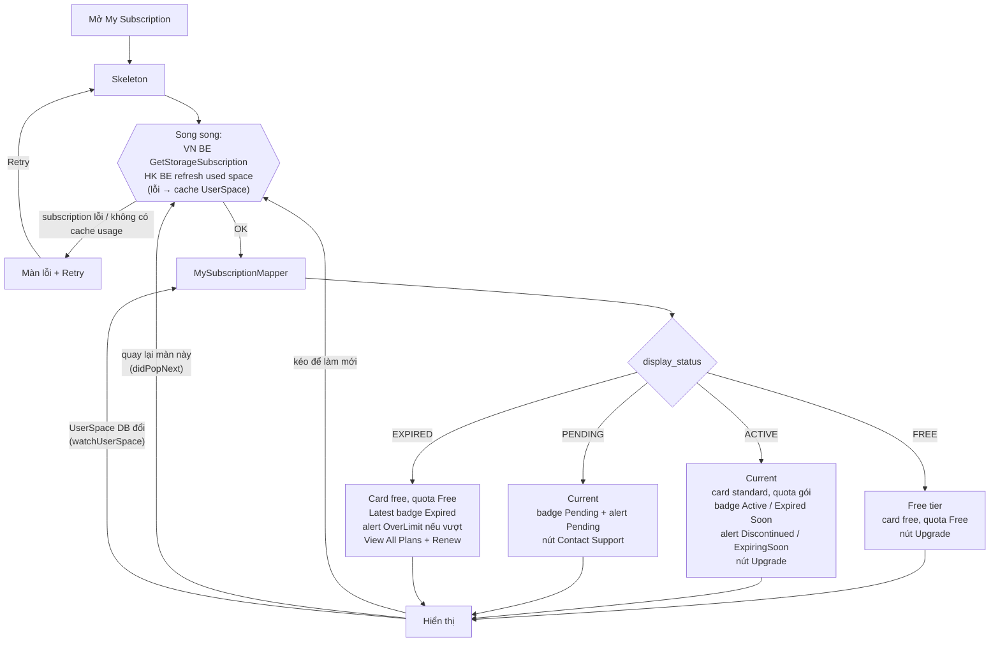

# My Subscription — map dữ liệu gRPC → UI (kiểm tra & chốt quy tắc)

> Ngày chốt: 2026-10-09 · Màn: `lib/features/cloud_storage/pages/new_upgrade/my_subscription/`
> Doc UI chi tiết (spec giao diện, l10n, lịch sử): `.claude/document/upgrade/UI doc/my-subscription.md`
> Cột **Code** trong các bảng: ✅ đã đúng · 🛠 cần làm (chạy `/agents-plan` với spec này).

## 1. Mục tiêu & phạm vi

**Mục tiêu.** Kiểm tra toàn bộ đường đi dữ liệu của màn My Subscription — gRPC `GetStorageSubscription` (**VN BE**) và `UserSpace` (**HK BE**) → domain → `MySubscriptionMapper` → view model → widget — đối chiếu với các quyết định đã chốt với VN BE / PM, và chốt các quy tắc còn thiếu.

**Kết luận kiểm tra.** Không có chỗ nào sai so với các quyết định đã chốt trước đó (C1–C14). Lần kiểm tra này chốt thêm D1–D12; BR-07, BR-13, BR-14, BR-15, BR-17 đã code xong ngày 2026-10-09 (`/agents-plan`).

**Trong phạm vi**
- Map `display_status` + `plan` + ngày → các section của màn (Current / Latest / Free), badge, alert, nút.
- Nguồn và cách tính dung lượng (quota gói, quota Free, đã dùng).
- Định dạng hiển thị (ngày, tiền, dung lượng, số ngày còn lại).
- Hành vi tải / tải lại / lỗi.

**Ngoài phạm vi**
- Màn chọn gói / thanh toán (`subscribe_plan`, payment) — chỉ ghi nhận điểm ảnh hưởng.
- Gate `isProd` của luồng upgrade (tính năng đang phát triển, D11).
- Đích thật của nút Contact Support (chờ PM / BA).

## 2. Actor & thuật ngữ

| Thuật ngữ | Nghĩa |
|---|---|
| Người dùng | Chủ tài khoản cloud xem gói của mình |
| VN BE | gRPC `subscription.v1.authz.StorageUserSubscriptionHandler/GetStorageSubscription` (`data/_grpc/`) |
| HK BE | Storage node REST `GET /api/v1/user/space/{netId}` (dung lượng đã dùng) + WS `userSpace` 20036 (`free_space`, `buy_space`) |
| Current | `CurrentSubscriptionViewModel`: gói trả phí đang chạy / đang kích hoạt (header + card ngày) |
| Latest | `LatestSubscriptionViewModel`: gói trả phí gần nhất đã hết hạn |
| Free tier | Màn khi chưa từng mua gói (`FreePlanInfo`) |
| Quota Free | `UserSpace.freeDefaultBytes` (= `free_space` của WS 20036) |
| Quota gói | `plan.storage_quota` × 1024^`storage_unit` |

## 3. User stories

- **US-1** Là người dùng **chưa mua gói**, tôi thấy mình đang ở gói Free, quota Free và nút Upgrade.
- **US-2** Là người dùng có **gói đang chạy**, tôi thấy tên gói, trạng thái, kỳ hạn, số tiền đã trả, ngày bắt đầu / hết hạn, số ngày còn lại, và được cảnh báo khi gói sắp hết hạn hoặc bị ngừng bán.
- **US-3** Là người dùng **vừa thanh toán**, tôi thấy gói đang được kích hoạt (Pending) và có nút liên hệ hỗ trợ.
- **US-4** Là người dùng có **gói đã hết hạn**, tôi thấy mình quay về Free, thông tin gói cũ, cảnh báo nếu dùng vượt quota Free, và có thể gia hạn.
- **US-5** Là người dùng, tôi luôn thấy dung lượng đã dùng / tổng mới nhất, và màn tự cập nhật khi tôi quay lại từ màn khác (thanh toán, quản lý dung lượng…).

## 4. Luồng nghiệp vụ

**Các bước**
1. Mở màn → skeleton.
2. Gọi song song: VN BE `GetStorageSubscription` và HK BE refresh dung lượng đã dùng. Refresh dung lượng lỗi → dùng `UserSpace` đã cache; không có cache → cả lần tải lỗi.
3. Lỗi ở lần tải đầu → màn lỗi + Retry. Lỗi khi đã có nội dung → giữ nội dung, toast "Something went wrong".
4. `MySubscriptionMapper` dựng view model theo [BR-01…BR-13](#5-quy-tắc-nghiệp-vụ).
5. Màn tải lại ngầm khi: kéo để làm mới; quay lại màn này từ màn khác (D4). Không tải lại khi app quay lại foreground (D5).
6. Dung lượng đã dùng / tổng tự cập nhật khi `UserSpace` trong DB đổi (D6), không cần gọi lại VN BE.

**Luồng phụ — từ các nút**

| Nút | Đích |
|---|---|
| Upgrade (FREE) | `pushUpgradeStorage` (prod: toast "Coming soon" — D11) |
| Upgrade (ACTIVE) | `pushUpgradePlan(CurrentPlanModelView từ Current)` |
| Contact Support (PENDING) | Toast "Coming soon" (`Toast.warm(comingSoon)`), chờ đích thật |
| View All Plans (EXPIRED) | `pushUpgradeStorage` (danh sách gói, không đánh dấu gói nào; prod: toast "Coming soon" — D11) |
| Renew (EXPIRED) | `pushUpgradePlan(CurrentPlanModelView từ Latest, unusedValue 0)`; thiếu `end_time` → `pushUpgradeStorage` |
| Manage Storage | `pushStorageManagement` |
| Icon đồng hồ | `pushPlanTransactionHistory` |
| Thanh toán thành công → "View plan" | Mở My Subscription (D4b) |

## 5. Quy tắc nghiệp vụ

| ID | Quy tắc | Nguồn | Code |
|---|---|---|---|
| **BR-01** | Map theo `display_status` (VN BE chỉ trả 4 giá trị): | C1–C4, C6, C7, C14 | ✅ |
| | `FREE` → `plan` luôn null → Free tier | | |
| | `ACTIVE` → `plan` luôn có → Current | | |
| | `PENDING` → `plan` luôn có → Current | | |
| | `EXPIRED` → `plan` luôn có → card Free + Latest | | |
| **BR-02** | `ACTIVE`/`PENDING` luôn có `start_time` và `end_time` | C9 | ✅ |
| **BR-03** | `ACTIVE`, xét theo thứ tự: `!available_to_renew` → `PlanDiscontinuedAlert`, badge `expiredSoon` nếu `is_expiring_soon` ngược lại `active` · `is_expiring_soon` → badge `expiredSoon` + `PlanExpiringSoonAlert(daysLeft, atRiskBytes)` · còn lại badge `active`, không alert. Nút: Upgrade | C1 | ✅ |
| **BR-04** | `PENDING` luôn thắng `is_expiring_soon` / `!available_to_renew`: badge `pending`, `PlanPendingAlert`, card standard + quota gói, nút **Contact Support** (toast "Coming soon") | C3, C8, C10, C11 | ✅ |
| **BR-05** | `EXPIRED`: card `free`, số trên card = quota Free, không có tên gói ở card, Latest badge `expired` (tên, quota, kỳ hạn, số tiền, ngày); `PlanOverLimitAlert(used, quota Free)` **chỉ khi** đã dùng > quota Free; nút View All Plans + Renew (luôn có) | C4, C12 | ✅ |
| **BR-06** | `FREE`: card `free`, quota Free, tên "Free", `FreePlanInfo`, nút Upgrade, **không có alert** (upload đã bị chặn theo quota nên FREE không vượt được) | C2, D3 | ✅ |
| **BR-07** | Quota Free = `UserSpace.freeDefaultBytes`; **nếu bằng 0** (WS 20036 chưa về, máy mới cài…) → dùng `resolveCloudQuotaBytes` / `kDefaultFreeSpaceBytes` (5 GiB, `shared/utils/storage_quota_config.dart`). Chỉ áp trong mapper của màn này, không sửa `UserSpaceMapper` dùng chung | D8 | ✅ |
| **BR-08** | Quota gói = `storage_quota` × 1024^`ByteUnit.index` (`B/KB/MB/GB/TB`, không phân biệt hoa thường; đơn vị lạ → coi là bytes + log) | doc §8 | ✅ |
| **BR-09** | Kỳ hạn = `duration_value` × `duration_unit` (`MONTH`/`YEAR`); không có gói ngày, đơn vị lạ → Monthly. "1 x Yearly" = `duration_value` | C5 | ✅ |
| **BR-10** | `daysLeft` = max(0, ⌈(`end_time` − giờ điện thoại) / 1 ngày⌉). `end_time` là UTC; phép trừ so thời điểm tuyệt đối nên không lệch múi giờ | D10 | ✅ |
| **BR-11** | Số tiền luôn hiện `$` (`planAmount(amount, 'USD')`); `currency` của BE (vd `USDT`) chỉ giữ cho logic | doc §8 | ✅ |
| **BR-12** | Ngày đổi sang giờ máy rồi format: `en` → "31 Jan 2026", locale khác `DateFormat.yMMMd`; ngày của Latest thiếu → "-" | doc §8 | ✅ |
| **BR-13** | `ACTIVE`/`PENDING` có `plan.name` rỗng (proto3 có thể trả `''`) → hiện **"-"** ở header và dòng "Plan" của Latest | D2 | ✅ |
| **BR-14** | Panel dung lượng = `UserSpace.usedBytes` / `totalBytes`, **cập nhật live** qua `watchUserSpace()`. Số trên card (quota gói / quota Free) có thể khác "Total" ở panel (PENDING: quota chưa cộng; EXPIRED: `buy_space` chưa thu hồi) — chấp nhận, FE không can thiệp | C13, D1, D6 | ✅ |
| **BR-15** | Tải lại: lần đầu skeleton; lỗi không có nội dung → màn lỗi + Retry; kéo để làm mới giữ nội dung; **tải lại ngầm mỗi khi màn hiện lại** (`RouteAware.didPopNext`); không tải lại khi app resume | D4, D5 | ✅ |
| **BR-16** | Mọi lỗi (offline, unauthenticated, server, timeout) dùng chung một toast "Something went wrong" / màn lỗi chung | D7 | ✅ |
| **BR-17** | Popup thanh toán thành công, nút "View plan" → mở My Subscription | D4b | ✅ |

## 6. Dữ liệu & API

### VN BE — gRPC `GetStorageSubscription` (request `{}`)

| Field | Kiểu proto | Domain (`StorageSubscription`) | Dùng cho | Ghi chú |
|---|---|---|---|---|
| `id` | int64 | `id: int` | — | FREE → 0 |
| `plan` | message | `plan: StorageSubscriptionPlan?` | BR-01 | `hasPlan()` false → null |
| `plan.name` | string | `name` (có thể `''`) | header, Latest | BR-13 |
| `plan.storage_quota` + `storage_unit` | int64 + string | `storageBytes` | card ACTIVE/PENDING, Latest | BR-08 |
| `plan.duration_value` + `duration_unit` | int64 + string | `durationValue`, `durationUnit` | kỳ hạn | BR-09 |
| `plan.amount` | double | `amount` | số tiền đã trả | BR-11 |
| `plan.currency` | string | `currency` | chỉ logic | BR-11 |
| `plan.available_to_renew` | bool | `availableToRenew` | alert Discontinued | BR-03 |
| `display_status` | string | enum (`trim().toUpperCase()`; lạ → `unknown`) | BR-01 | |
| `provisioning_status` | string | — | không dùng | BE xác nhận chưa có ý nghĩa |
| `start_time`, `end_time` | Timestamp | `DateTime?` (UTC, `hasX()` false → null) | ngày, `daysLeft` | BR-02, BR-10, BR-12 |
| `is_expiring_soon` | bool | `isExpiringSoon` | badge / alert | BR-03 |

Code: `data/_grpc/mapper/storage_subscription_mapper.dart` → `data/repository/subscription/storage_subscription_repository_impl.dart` → `domain/use_cases/subscription/get_storage_subscription_use_case.dart`. Timeout 15s / lần, `unavailable` / `deadlineExceeded` retry 1 lần (`shared/network/grpc_retry_interceptor.dart`). Không có giờ server trong response.

### HK BE — `UserSpace`

| Field domain | Nguồn | Ghi chú |
|---|---|---|
| `usedBytes` | REST storage node `GET /api/v1/user/space/{netId}` qua `RefreshUsedSpaceUseCase` (timeout 10s) | Lỗi → dùng cache (`GetCachedUserSpaceUseCase`) |
| `totalBytes` | WS 20036: `free_space + buy_space` (cache DB) | Chỉ đến từ WS |
| `freeDefaultBytes` | WS 20036: `free_space` (cache DB) | = 0 khi chưa có row / WS chưa về → BR-07 |

Không có API mới, không cần BE làm thêm (trừ các xác nhận ở [mục 12](#12-việc-còn-mở--cần-be-hoặc-design-xác-nhận)).

## 7. Màn hình & trạng thái UI + l10n

| Trạng thái | Hiển thị |
|---|---|
| Đang tải lần đầu | `MySubscriptionSkeleton` |
| Lỗi lần đầu | `icCloudFail` + `somethingWentWrongPleaseTryAgain` + nút `retry` |
| Có nội dung | Header (Current) → card → card ngày (Current) → `FreePlanInfo` (FREE) → Latest → alert; panel đáy cố định |
| Refresh lỗi | Giữ nội dung + `CloudBannerToast` `somethingWentWrong` |
| Đang tải lại ngầm (didPopNext / watch) | Giữ nội dung, không skeleton |

| Status | Card | Section | Badge | Alert | Nút |
|---|---|---|---|---|---|
| FREE | free / quota Free | FreePlanInfo | — | — | Upgrade |
| ACTIVE | standard / quota gói | Current | Active / Expired Soon | Discontinued / ExpiringSoon / — | Upgrade |
| PENDING | standard / quota gói | Current | Pending | Pending | Contact Support |
| EXPIRED | free / quota Free | Latest | Expired | OverLimit (nếu vượt) / — | View All Plans · Renew |

**l10n: không có key mới.** Dùng lại key cloud có sẵn: `upgradeButton`, `viewAllPlans`, `renew`, `paymentContactSupport`, `comingSoon`, `somethingWentWrong`, `somethingWentWrongPleaseTryAgain`, `retry`, `freePlanName`, `youAreOnPlan`, `planStorageIncludedDesc`, `subscriptionActive/ExpiredSoon/Pending/Expired`, `billingYearlyCount/MonthlyCount`, `amountPaid`, `started`, `expiredOn`, `daysLeft`, `daysCount`, `latestSubscription`, `plan`, `planExpiredPlanSize`, `term`, `termYears/termMonths`, `paid`, `startedOn`, `sizeIsReadOnly`, `storageFullDescription`, `planExpiresInDays`, `renewToKeepStorage`, `planPendingTitle/Desc`, `planDiscontinuedTitle/Desc`, `storageLimitUsed`, `storageTotalSize`, `storagePercentUsed`, `storageFreeSize`, `manageStorage`, `yourFreePlan`, `yourPlanStorage`. Giá trị "-" (BR-12, BR-13) là ký tự cố định, không dịch.

## 8. Edge case & xử lý lỗi

| Tình huống | Hành vi mong muốn | Code |
|---|---|---|
| VN BE lỗi / timeout / offline / unauthenticated (sau refresh token) | Lần đầu: màn lỗi + Retry. Đã có nội dung: giữ + toast chung | ✅ |
| HK BE refresh dung lượng lỗi, có cache | Dùng cache, màn bình thường | ✅ |
| HK BE lỗi, không có cache | Như VN BE lỗi | ✅ |
| `freeDefaultBytes` = 0 (máy mới cài, WS 20036 chưa về, WS lỗi) | Quota Free = 5 GiB fallback; không bật OverLimit sai | ✅ BR-07 |
| WS 20036 về sau khi màn đã hiện | Panel và quota tự cập nhật (watch) | ✅ BR-14 |
| `plan.name` rỗng (ACTIVE/PENDING) | "-" | ✅ BR-13 |
| EXPIRED thiếu `end_time` | "Expired on" = "-", Renew → `pushUpgradeStorage` | ✅ |
| EXPIRED: `buy_space` chưa thu hồi (Total > quota Free) | Alert theo quota Free, panel theo Total — chấp nhận, **điểm cần test** | ✅ (D1) |
| PENDING: quota chưa cộng | Card quota gói, panel Total cũ — chấp nhận | ✅ (C13) |
| Giờ điện thoại sai | `daysLeft` có thể lệch với badge của BE — chấp nhận | ✅ (D10) |
| Quay lại từ thanh toán / Storage Management / huỷ Upgrade | Tải lại ngầm, hiện gói mới | ✅ BR-15 |
| Để màn mở qua nửa đêm / app resume | Không tự cập nhật; kéo để làm mới | ✅ (D5) |
| Kéo để làm mới liên tục, response về không theo thứ tự | Bỏ response cũ (`_requestId`) | ✅ |
| Rời màn khi đang tải | Không emit sau `close()` | ✅ |
| Chờ lâu (gRPC 15s × 2) | Skeleton tới ~30s rồi lỗi — chấp nhận | ✅ |

## 9. Acceptance criteria

- **AC-01 (BR-01, BR-06)** Given `display_status = FREE`, When mở màn, Then card Free hiện quota Free, có "You're on the Free plan", nút Upgrade, không có header / Latest / alert.
- **AC-02 (BR-03)** Given `ACTIVE`, `available_to_renew = true`, `is_expiring_soon = false`, When mở màn, Then header "{tên} [Active]", "{n} x Monthly|Yearly · ${amount} paid", card standard quota gói, card ngày đủ 3 dòng, không alert, nút Upgrade.
- **AC-03 (BR-03)** Given `ACTIVE`, `is_expiring_soon = true`, `available_to_renew = true`, When mở màn, Then badge Expired Soon, "Days left" màu cam, alert "Your plan expires in {n} days".
- **AC-04 (BR-03)** Given `ACTIVE`, `available_to_renew = false`, When mở màn, Then alert Discontinued (không có alert sắp hết hạn).
- **AC-05 (BR-04)** Given `PENDING` (kể cả `is_expiring_soon = true` hoặc `available_to_renew = false`), When mở màn, Then badge Pending, alert Pending, nút Contact Support; When bấm nút, Then toast "Coming soon".
- **AC-06 (BR-05)** Given `EXPIRED`, đã dùng > quota Free, When mở màn, Then card Free, Latest badge Expired + "Expired on" màu đỏ, alert "{used} is read-only", nút View All Plans + Renew.
- **AC-07 (BR-05)** Given `EXPIRED`, đã dùng ≤ quota Free, Then không có alert.
- **AC-08 (BR-07)** Given `freeDefaultBytes = 0`, When mở màn FREE / EXPIRED, Then card hiện "5 GB" và không bật OverLimit khi đã dùng ≤ 5 GiB.
- **AC-09 (BR-13)** Given `ACTIVE` với `plan.name = ''`, Then header hiện "-".
- **AC-10 (BR-14)** Given màn đang mở, When `UserSpace` trong DB đổi, Then panel cập nhật mà không skeleton.
- **AC-11 (BR-15)** Given màn đang mở, When người dùng đi sang màn khác rồi Back về, Then màn tải lại ngầm (giữ nội dung trong lúc tải).
- **AC-12 (BR-17)** Given thanh toán thành công, When bấm "View plan", Then đang ở My Subscription.
- **AC-13 (BR-16)** Given đã có nội dung, When kéo để làm mới và VN BE lỗi, Then nội dung giữ nguyên + toast "Something went wrong".
- **AC-14 (BR-10, BR-12)** Given `end_time` = 2026-01-31T20:00Z, máy ở UTC+7, Then "Expired on" hiện "1 Feb 2026" (en).

## 10. Test case

| # | Loại | Dữ liệu | Kỳ vọng |
|---|---|---|---|
| T01 | Happy | FREE, plan null, used 1.2 GB, free 5 GB | AC-01 |
| T02 | Happy | ACTIVE Standard 200 GB, YEAR×1, $917.99, còn 365 ngày | AC-02 |
| T03 | Happy | ACTIVE + `is_expiring_soon`, used 120 GB > free 5 GB | AC-03, alert có "Renew now to keep …" |
| T04 | Happy | ACTIVE + `is_expiring_soon`, used 1.2 GB ≤ free | AC-03, alert chỉ có tiêu đề |
| T05 | Happy | ACTIVE + `available_to_renew = false` (+/− `is_expiring_soon`) | AC-04 |
| T06 | Happy | PENDING (+ `is_expiring_soon`, + `!available_to_renew`) | AC-05 |
| T07 | Happy | EXPIRED, used 120 GB > free 5 GB | AC-06 |
| T08 | Happy | EXPIRED, used ≤ free | AC-07 |
| T09 | Edge | `freeDefaultBytes = 0` (xoá DB / máy mới, tắt WS) | AC-08 |
| T10 | Edge | ACTIVE `plan.name = ''` | AC-09 |
| T11 | Edge | EXPIRED thiếu `end_time` | "Expired on" "-", Renew → `pushUpgradeStorage` |
| T12 | Edge | EXPIRED, HK BE còn `buy_space` > 0 | **Test phối hợp VN BE ↔ HK BE** (D1): ghi lại alert vs panel |
| T13 | Edge | `duration_unit = DAY` | Hiện Monthly |
| T14 | Edge | `end_time` UTC gần nửa đêm, máy UTC+7 | AC-14 |
| T15 | Negative | Tắt mạng khi mở màn lần đầu | Màn lỗi + Retry; Retry khi có mạng → nội dung |
| T16 | Negative | Tắt mạng rồi kéo để làm mới | AC-13 |
| T17 | Negative | HK BE refresh lỗi, có cache | Nội dung từ cache |
| T18 | Flow | Upgrade (ACTIVE) → thanh toán thành công | Về My Subscription, popup; tải lại ngầm hiện gói mới (PENDING / ACTIVE) |
| T19 | Flow | "View plan" trên popup thành công (từ My Subscription và từ màn khác) | AC-12 |
| T20 | Flow | Manage Storage → xoá file → Back | Panel cập nhật (AC-10, AC-11) |
| T21 | Flow | Renew (EXPIRED) | Màn chọn gói đánh dấu gói cũ, unused value 0 |

## 11. Quyết định đã chốt & giả định đã xác nhận

| # | Câu hỏi | Quyết định | Nguồn |
|---|---|---|---|
| C1 | ACTIVE có `plan`? | Luôn có → Current | VN BE |
| C2 | FREE? | Chưa mua lần nào, `plan` null → Free | VN BE |
| C3 | PENDING hiện gì? | Current, badge Pending | Người dùng |
| C4 | Còn lại? | Latest (EXPIRED) | VN BE |
| C5 | Gói ngày? | Không có; đơn vị lạ → Monthly | Người dùng |
| C6 | Status khác? | Chỉ 4 status | VN BE |
| C7 | Sai hợp đồng `plan`? | Không xảy ra | VN BE |
| C8 | Nút PENDING | Contact Support | Người dùng |
| C9 | ACTIVE/PENDING có ngày? | Luôn có | VN BE |
| C10 | Bấm Contact Support | Toast "Coming soon" tới khi có đích | Người dùng |
| C11 | PENDING + expiring/discontinued | PENDING thắng | Người dùng |
| C12 | EXPIRED | Card Free + Latest | Người dùng |
| C13 | PENDING: card vs Total lệch | Chấp nhận (như Figma) | Người dùng |
| C14 | Khi nào `plan` null | Chỉ khi chưa kích hoạt gói lần nào | VN BE |
| D1 | EXPIRED: alert theo quota Free, panel theo Total | VN BE ↔ HK BE tự đồng bộ, FE không can thiệp; ghi điểm test | Người dùng |
| D2 | `plan.name` rỗng | "-" | Người dùng |
| D3 | FREE vượt quota? | Không thể (upload bị chặn) → không alert | Người dùng |
| D4 | Tải lại khi quay về màn | Tải lại ngầm mỗi khi màn hiện lại (`didPopNext`) | Người dùng |
| D4b | "View plan" | Mở My Subscription | Người dùng |
| D5 | Tải lại khi app resume | Không, chỉ kéo để làm mới | Người dùng |
| D6 | Dung lượng live | Có, `watchUserSpace()` | Người dùng |
| D7 | Phân loại lỗi | Không, một toast chung | Người dùng |
| D8 | `freeDefaultBytes = 0` | Fallback `resolveCloudQuotaBytes` (5 GiB) trong mapper màn này | Người dùng |
| D9 | Timestamp epoch-0 / zero-time | Không chặn ở client, **với điều kiện BE đảm bảo** (mục 12) | Người dùng |
| D10 | Giờ để tính `daysLeft` | Giờ điện thoại; `end_time` là UTC | Người dùng |
| D11 | Gate prod upgrade lệch nhau | Tạm bỏ qua, tính năng đang phát triển | Người dùng |
| D12 | Tiền tệ ở màn subscribe_plan | Phần người khác làm, không động vào | Người dùng |

Đã tự giải quyết bằng code / Figma (không cần hỏi): EXPIRED không hiện `FreePlanInfo` (Figma frame "Free – Subscriptions Expired"); copy "over the free limit" chỉ dùng ở EXPIRED nên đúng; khoảng cách 48 chỉ áp cho FREE; `cycleCount` = `duration_value` (design / BA đã xác nhận).

## 12. Việc còn mở / cần BE hoặc design xác nhận

**Cần BE xác nhận**
| # | Việc | Ai |
|---|---|---|
| O1 | EXPIRED / FREE: `start_time` / `end_time` hoặc không gửi, hoặc là ngày thật (không gửi epoch-0 / Go zero-time `0001-01-01`) — điều kiện của D9. Nếu không đảm bảo → data mapper coi `seconds <= 0` là null | VN BE |
| O2 | `plan.name` có luôn khác rỗng với ACTIVE / PENDING? (client đã có "-" theo D2) | VN BE |
| O3 | Thời điểm HK BE thu hồi `buy_space` khi gói hết hạn, và cộng quota khi PENDING → ACTIVE (D1, C13) — **test phối hợp T12** | VN BE + HK BE |
| O4 | Field số ngày còn lại / giờ server (câu hỏi mở cũ ở doc UI) — không bắt buộc theo D10 | VN BE |

**Cần PM / design**
| # | Việc |
|---|---|
| O5 | Đích thật của nút Contact Support (C10) |
| O6 | Trước khi lên prod: đồng bộ gate `isProd` giữa `pushUpgradeStorage` (toast "Coming soon") và `pushUpgradePlan` (không gate) (D11) |
| O7 | D4b: khi luồng thanh toán bắt đầu từ chính My Subscription, đề xuất **không push thêm** một My Subscription (tránh 2 màn trùng trong stack) mà chỉ đóng popup để D4 tải lại — chưa được xác nhận rõ |

**Ngoài màn / người khác làm**
| # | Việc |
|---|---|
| O8 | `CurrentPlanModelView.currency` mang `USDT` sang subscribe_plan, dòng "Unused value" có thể hiện "USDT0.00" thay vì "$" (D12) |

**Việc kỹ thuật đã ghi nhận (không phải quy tắc nghiệp vụ)**
- R4: `atRiskBytes` truyền toàn bộ `usedBytes`, comment nói chỉ phần vượt quota Free — cần chốt một trong hai.
- R5: nhánh phòng hờ của mapper truyền `planName: plan?.name` → nên để null (thực tế chỉ FREE đi vào nhánh này).
- R6: route cast `state.extra as MySubscriptionViewModel?` không kiểm tra kiểu, `.preview` không có guard debug.
- R7: `MySubscriptionCubit.unavailable()` không còn ai dùng.
- `catch (_)` trong cubit không log; lỗi map dữ liệu trông như mất mạng. Nhánh `display_status` lạ không log.
- `GetCachedUserSpaceUseCase` dùng `.first` trên broadcast stream không `onCancel` → rò ObjectBox watcher (D6 có thể thay thế).
- Logout / login lại giữ row `UserSpace` cũ cho tới khi WS 20036 về.
- Card storage có tỉ lệ cố định 361/108, có thể tràn chiều dọc khi cỡ chữ hệ thống lớn; label nút ru / ja dễ bị cắt khi có 2 nút.
- `ClientChannel(_uri.host)` bỏ qua port trong `SUBSCRIPTION_BASE_URL`.
- Chưa có unit test cho `StorageSubscriptionMapper`, `UserSpaceMapper`, `MySubscriptionMapper`, `MySubscriptionCubit`.
