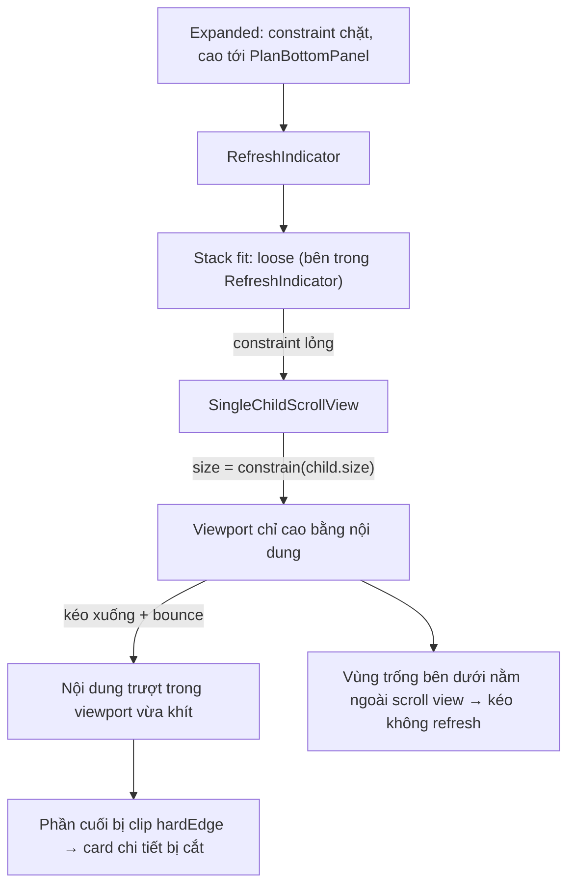

# Bug: My Subscription — pull-to-refresh cắt mất `_CurrentSubscriptionDetails`

> Loại: bug UI/layout · Module: `cloud_storage` · Màn: My Subscription
> File chính: `lib/features/cloud_storage/pages/new_upgrade/my_subscription/my_subscription_page.dart`

## 1. Mục tiêu & phạm vi

**Mục tiêu:** vùng cuộn của My Subscription luôn kéo tới `PlanBottomPanel`. Khi pull-to-refresh, nội dung không bị cắt ngay ở mép dưới của chính nó.

**In scope**
- Sửa layout vùng cuộn trong `_Content` (`my_subscription_page.dart:155-182`).
- Áp dụng cho mọi trạng thái gói, trên cả iOS và Android.

**Out of scope**
- Đổi physics: giữ bounce theo `BouncingScrollBehavior` global (`lib/main.dart:97`).
- Thay đổi design hoặc chiều cao `PlanBottomPanel`.
- Cùng pattern lỗi ở `plan_transaction_detail_page.dart` (xem mục 12).
- Cubit, mapper, data, API: không thay đổi.

## 2. Actor & thuật ngữ

| Thuật ngữ | Nghĩa |
|---|---|
| Vùng cuộn / viewport | `SingleChildScrollView` nằm trong `Expanded`, phía trên `PlanBottomPanel` |
| `PlanBottomPanel` | Panel cố định (sticky) ở đáy: usage, Manage storage, nút hành động (~230h) |
| `_CurrentSubscriptionDetails` | Card Started / Expired on / Days left của gói hiện tại |
| Bounce | `BouncingScrollPhysics`, được app áp dụng cho mọi nền tảng |

Actor: người dùng đang mở màn My Subscription.

## 3. User stories

- **US-01:** Là người dùng, khi kéo để làm mới màn My Subscription, tôi không muốn thấy card thông tin gói bị cắt cụt ngay lập tức.
- **US-02:** Là người dùng, tôi muốn kéo ở bất kỳ đâu trong vùng nội dung, kể cả khoảng trống bên dưới các card, để làm mới.

## 4. Luồng & nguyên nhân gốc

**Bằng chứng (Flutter SDK 3.44.8)**
- `RefreshIndicator.build` trả về `Stack(children: [child, ...])` với `fit` mặc định là `loose` (`material/refresh_indicator.dart:640`). Child nhận constraint đã nới lỏng.
- `_RenderSingleChildViewport.performLayout` đặt `size = constraints.constrain(child!.size)` (`widgets/single_child_scroll_view.dart:503`). Khi constraint lỏng, viewport co về đúng chiều cao nội dung.
- App áp `BouncingScrollPhysics` cho mọi nền tảng (`lib/main.dart:97`). Khi kéo, nội dung trượt xuống và bị clip ở mép dưới viewport vừa khít đó.

**Luồng sau khi sửa**
1. Người dùng kéo xuống ở bất kỳ vị trí nào trong vùng cuộn, kể cả khoảng trống.
2. Nội dung trượt xuống (bounce) trong một viewport cao tới `PlanBottomPanel`.
   - Nội dung ngắn: nội dung chỉ bắt đầu bị khuất khi chạm mép `PlanBottomPanel`.
   - Nội dung dài: phần đáy khuất dưới panel trong lúc kéo. Đây là hành vi chấp nhận được.
3. Thả tay: `cubit.refresh()` chạy, nội dung nảy về vị trí cũ, dữ liệu cũ giữ nguyên tới khi có dữ liệu mới.

## 5. Quy tắc nghiệp vụ

| ID | Quy tắc |
|---|---|
| BR-01 | Vùng cuộn luôn chiếm toàn bộ chiều cao từ dưới app bar tới mép trên `PlanBottomPanel`, bất kể nội dung dài hay ngắn. |
| BR-02 | Giữ hiệu ứng bounce. Nội dung bị khuất **trong lúc kéo** là bình thường. |
| BR-03 | Lúc đứng yên, mọi section (gồm `_CurrentSubscriptionDetails`) thấy được đầy đủ: hoặc nằm trong khung, hoặc cuộn xuống là thấy. Không bắt buộc vừa màn hình mà không cần cuộn. |
| BR-04 | Pull-to-refresh kích hoạt được khi kéo ở bất kỳ điểm nào trong vùng cuộn, kể cả khoảng trống dưới nội dung. |

## 6. Dữ liệu & API

Không thay đổi. Cubit (`MySubscriptionCubit.refresh`), mapper, use case và BE (VN `_grpc`) giữ nguyên.

## 7. Màn hình & trạng thái UI

| Trạng thái | Ảnh hưởng |
|---|---|
| Loaded (mọi frame: Active, Expiring soon, Discontinued, Pending, Free, Expired) | Áp dụng BR-01…BR-04 |
| Loading lần đầu (`MySubscriptionSkeleton`) | Không có pull-to-refresh, không đổi |
| Lỗi lần đầu (`_LoadError`) | Không có pull-to-refresh, không đổi |

**Hướng sửa đề xuất** (để `/agents-plan` hoặc "code đi" dùng): trong `_Content`, bọc `SingleChildScrollView` bằng `SizedBox.expand(...)`, đặt ngay dưới `RefreshIndicator`. Giữ nguyên `physics`, `padding` và `Column`. `SizedBox.expand` tự lấy hết constraint lỏng nên truyền constraint chặt xuống scroll view, và không thêm `Scrollable` nên `notification.depth` của `RefreshIndicator` vẫn là 0. Pattern tương tự đang dùng ở `storage_management_page.dart:429`.

**l10n:** không có key mới.

## 8. Edge case & xử lý lỗi

| Tình huống | Hành vi mong muốn |
|---|---|
| Nội dung ngắn hơn vùng cuộn (Active không banner, Free) | Viewport vẫn cao tới `PlanBottomPanel`. Kéo xuống thì nội dung trượt vào khoảng trống, không bị cắt ngay. |
| Nội dung dài hơn vùng cuộn (máy nhỏ, có banner hoặc Latest Subscription) | Cuộn bình thường. Lúc kéo, đáy khuất dưới panel (BR-02). Lúc đứng yên, cuộn xuống là thấy (BR-03). |
| Kéo ở khoảng trống bên dưới nội dung | Kích hoạt refresh (BR-04). |
| Refresh lỗi khi đã có nội dung | Giữ nội dung, hiện toast lỗi như hiện tại. Layout không đổi. |
| Refresh trả về frame khác (vd. Active thành Expired) | Nội dung đổi chiều cao. Viewport vẫn fill (BR-01). |
| Xoay màn hình hoặc split view đổi kích thước | Viewport fill theo kích thước mới. |
| Dark mode | Không ảnh hưởng. |

## 9. Acceptance criteria

- **AC-01 (BR-01):** Given đang ở My Subscription với nội dung ngắn hơn vùng cuộn, When màn hiển thị xong, Then vùng cuộn kéo dài tới mép trên `PlanBottomPanel`. Có thể kiểm tra bằng Flutter Inspector: chiều cao `SingleChildScrollView` bằng chiều cao `Expanded`.
- **AC-02 (BR-01, BR-02):** Given nội dung ngắn hơn vùng cuộn, When kéo xuống một đoạn nhỏ hơn khoảng trống phía dưới nội dung, Then không section nào bị cắt.
- **AC-03 (BR-02):** Given nội dung dài hơn vùng cuộn, When kéo xuống, Then nội dung nảy theo bounce, phần đáy có thể khuất dưới panel. Thả tay thì nội dung trở về vị trí cũ.
- **AC-04 (BR-03):** Given bất kỳ trạng thái gói nào và thiết bị bất kỳ, When màn đứng yên sau khi load hoặc refresh, Then `_CurrentSubscriptionDetails` hiện đầy đủ, hoặc thấy đầy đủ sau khi cuộn xuống.
- **AC-05 (BR-04):** Given nội dung ngắn hơn vùng cuộn, When kéo xuống từ khoảng trống bên dưới các card, Then vòng refresh hiện và `refresh()` được gọi.

## 10. Test case

| # | Loại | Bước | Kỳ vọng |
|---|---|---|---|
| TC-01 | Happy | Gói Active không banner, máy màn lớn → kéo xuống ~100px | Card chi tiết không bị cắt; refresh chạy |
| TC-02 | Happy | Như TC-01, kéo từ khoảng trống dưới card | Refresh chạy (trước khi sửa: không chạy) |
| TC-03 | Happy | Free tier → kéo xuống | `FreePlanInfo` không bị cắt ngay |
| TC-04 | Edge | Gói Expiring soon có banner, máy nhỏ (iPhone SE / Android màn thấp) → đứng yên | Cuộn xuống thấy đủ card chi tiết và banner |
| TC-05 | Edge | Như TC-04 → kéo xuống | Đáy khuất dưới panel lúc kéo (chấp nhận); thả ra nội dung về đúng chỗ |
| TC-06 | Edge | Expired (Latest Subscription + banner) → kéo / cuộn | Như TC-04, TC-05 |
| TC-07 | Edge | Pending → kéo | Không bị cắt ngay nếu nội dung ngắn |
| TC-08 | Negative | Tắt mạng → kéo refresh | Giữ nội dung, hiện toast lỗi, layout vẫn fill |
| TC-09 | Regression | Lần đầu vào màn (skeleton), lỗi lần đầu (Retry) | Không thay đổi |
| TC-10 | Regression | Lặp TC-01…TC-08 trên iOS và Android, light và dark | Như trên |

## 11. Quyết định đã chốt

| Q | Câu hỏi | Trả lời |
|---|---|---|
| Q1 | Hiện tượng chính xác | Scroll view chỉ cao vừa nội dung; muốn fill tới `PlanBottomPanel` |
| Q2 | Nền tảng | Cả iOS và Android |
| Q3 | Hành vi khi kéo | Giữ bounce; khuất lúc kéo là bình thường; lúc đứng yên card hiện đủ (đã đổi từ "nội dung đứng yên") |
| Q4 | Trạng thái gói | Tất cả |
| Q5 | Glow mép dưới khi clamp | Đóng, không áp dụng vì không đổi physics |
| Q6 | Sửa cả `plan_transaction_detail_page.dart`? | Không; ghi vào việc còn mở |
| Q7 | "Hiện đủ lúc đứng yên" | Thấy được đầy đủ, cuộn xuống là thấy; không cần vừa màn hình |

Giả định: không còn giả định nào chưa xác nhận. Giả thuyết H2 (lỗi data làm `current == null`) đã bị loại.

## 12. Việc còn mở

- `lib/features/cloud_storage/pages/new_upgrade/transaction_history/plan_transaction_detail_page.dart:108-113` dùng cùng pattern `RefreshIndicator > SingleChildScrollView` trong `Expanded`, nên tiềm ẩn cùng lỗi. Trang đó ít lộ vì nội dung dài. Cần tách ticket riêng nếu muốn sửa.
- Không cần BE hay design xác nhận.
