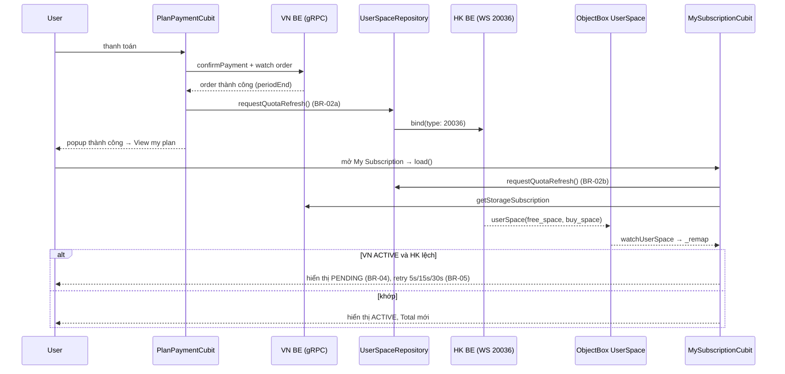

# Bug ZT-6625: Dung lượng cũ vẫn hiển thị sau khi mua gói thành công

> Loại: bug (codeerror) · Module: `cloud_storage` · Màn: My Subscription, Manage Storage
> Nguồn: [ZenTao bug#6625](https://zentao.oasoft.xyz:4433/zentao/bug-view-6625.html) · Ticket: `zt-6625-old-storage-after-purchase.ticket.md`

## 1. Mục tiêu & phạm vi

**Mục tiêu:** sau khi mua gói thành công, ô dung lượng ở My Subscription và ở Manage Storage hiển thị đúng tổng dung lượng mới. Nếu hai server chưa khớp nhau, My Subscription báo rõ là gói đang kích hoạt (PENDING) thay vì hiện ACTIVE kèm số cũ.

**In scope**
- Thêm cách để FE chủ động yêu cầu quota từ HK BE (WS `userSpace` 20036) qua domain contract mới.
- Gửi yêu cầu này ở 3 thời điểm (BR-02).
- My Subscription: khi VN ACTIVE nhưng lệch quota với HK thì hiển thị PENDING (BR-04). Đồng thời retry yêu cầu quota (BR-05).

**Out of scope**
- Màn Home: `bind(type: 20036)` ở pull-to-refresh giữ nguyên (Q12).
- `_handleGetPurchaseStatus` (luồng mua cũ của HK qua WS): đoạn đang comment giữ nguyên (Q11).
- `UsedSpaceSyncWorker` / `refreshUsedSpace()`: không đổi, vì chúng chỉ lấy used bytes.
- Các nơi khác hiển thị Total (thanh dung lượng ở Home, popup storage limit, banner): không đổi.
- BE: đồng bộ quota VN → HK, cũng như đơn vị và ngữ nghĩa `buy_space` (mục 12).

## 2. Actor & thuật ngữ

| Thuật ngữ | Nghĩa |
|---|---|
| VN BE | gRPC subscription/order (`data/_grpc`). Nguồn của gói: `StorageSubscription.plan.storageBytes` = quota × 1024^n |
| HK BE | WS `userSpace` 20036 gửi `free_space`, `buy_space`. App lưu `freeSpace = free_space + buy_space` vào ObjectBox `UserSpaceEntity`, rồi map ra `UserSpace.totalBytes` |
| Quota HK / `totalBytes` | Tổng dung lượng hiển thị ở ô "Total / Free" của cả hai màn |
| Yêu cầu quota | Gửi WS message type 20036 (`bind(type: 20036)`). Phản hồi đi theo đường WS → DB, không trả về trực tiếp cho caller |
| Lệch quota | VN ACTIVE, `totalBytes > 0` và `totalBytes != plan.storageBytes` |

Actor: người dùng vừa mua hoặc nâng cấp gói, hoặc đang mở My Subscription / Manage Storage.

## 3. User stories
- **US-01:** Là người dùng vừa mua gói, tôi muốn My Subscription hiện đúng tổng dung lượng mới để biết gói đã có hiệu lực.
- **US-02:** Là người dùng, tôi muốn Manage Storage hiện đúng tổng dung lượng mới sau khi mua.
- **US-03:** Là người dùng, khi hai hệ thống chưa đồng bộ xong, tôi muốn thấy gói đang ở trạng thái "đang kích hoạt" thay vì một con số sai.

## 4. Luồng & nguyên nhân gốc

**Nguyên nhân gốc:** cả hai màn lấy Total từ `UserSpace.totalBytes`, và giá trị này **chỉ** được ghi khi nhận WS 20036 ([cloud_storage_ws_observe_manger.dart:181-197](../../../../../lib/features/cloud_storage/data/websocket/cloud_storage_ws_observe_manger.dart)). Gói được mua qua VN gRPC. Sau khi gói ACTIVE, app không yêu cầu 20036, nên DB giữ quota cũ cho tới khi HK tự push hoặc người dùng kéo làm mới ở Home.

Hai màn đều đã theo dõi DB live:
- My Subscription: `watchUserSpace()` → `_remap`.
- Manage Storage: `WatchStorageManagementUseCase` (`storageLimit = userSpace.totalBytes`).

Vì vậy chỉ cần quota mới về DB là UI tự cập nhật.

**Luồng phụ**
- Manage Storage: bloc `_Started` gọi `requestQuotaRefresh()` (BR-02c) cùng lúc với `_refreshSummary()`. WS về thì summary tự cập nhật.
- My Subscription pull-to-refresh, hoặc reload khi quay lại màn (`didPopNext` → `refresh()`/`load()`): cũng gọi `requestQuotaRefresh()`.

## 5. Quy tắc nghiệp vụ

| ID | Quy tắc |
|---|---|
| **BR-01** | Total/Free ở ô dung lượng của My Subscription và Manage Storage luôn là quota HK (`UserSpace.totalBytes`), giữ BR-14 cũ. FE không thay số bằng `plan.storageBytes`. |
| **BR-02** | FE yêu cầu quota (WS 20036) tại: **(a)** sau khi `PlanPaymentCubit.waitForActivation()` xác nhận order thành công và có `periodEnd`, trước khi trả kết quả; **(b)** mỗi lần `MySubscriptionCubit.load()` / `refresh()`; **(c)** khi `StorageManagementBloc` nhận `_Started`. |
| **BR-03** | Yêu cầu quota chạy kiểu fire-and-forget: không chờ phản hồi, không báo lỗi. WS mất kết nối thì yêu cầu mất mà không có thông báo (Q9). |
| **BR-04** | My Subscription: VN `displayStatus == active` (gồm expiring soon và discontinued), HK đã có số (`totalBytes > 0`) và `totalBytes != plan.storageBytes` (so chính xác từng byte) ⇒ hiển thị **giống hệt PENDING**: badge `PlanBadge.pending`, alert `PlanPendingAlert`, action `[PlanAction.contactSupport]`. Card gói, ngày bắt đầu/hết hạn và số ngày còn lại vẫn hiển thị như PENDING hiện có. |
| **BR-05** | Khi BR-04 đúng, My Subscription gửi lại yêu cầu quota sau 5s, 15s, 30s. Dừng khi hết lệch (màn chuyển ACTIVE) hoặc sau 3 lần. Sau đó giữ PENDING cho tới khi WS về số khớp (live) hoặc người dùng `refresh()`/`load()` (bộ đếm reset). `close()` huỷ timer. Timer này độc lập với retry expiry đang có. |
| **BR-06** | HK chưa có số (`totalBytes == 0`: máy mới, WS chưa về) ⇒ không xét lệch, hiển thị theo VN như hiện tại. |
| **BR-07** | VN PENDING / EXPIRED / Free: giữ nguyên logic hiện tại, không xét lệch, không retry quota. |
| **BR-08** | Nhận WS 20036 khớp ⇒ `_remap` tính lại ⇒ PENDING do lệch tự chuyển ACTIVE, không cần thao tác. |
| **BR-09** | `_isRunning` / expiry timer vẫn dựa trên `displayStatus` của VN, không bị ảnh hưởng bởi PENDING do lệch. |
| **BR-10** | **Chống nháy (Free → PENDING → ACTIVE):** khi `load()`/`refresh()` nhận kết quả VN ACTIVE mà quota đang lệch (BR-04), cubit **chưa emit**. Màn giữ nguyên nội dung đang hiện (Free / gói cũ khi refresh, skeleton khi load đầu; pull-to-refresh vẫn xoay) và chờ `watchUserSpace` về số khớp, **tối đa 2 giây**. Khớp → emit thẳng ACTIVE. Hết 2 giây vẫn lệch → emit PENDING rồi bắt đầu retry BR-05. Kết quả khớp ngay, HK chưa có số, hoặc VN ≠ ACTIVE → emit ngay như cũ. Request mới (load/refresh khác) hoặc `close()` trong lúc chờ → bỏ kết quả cũ (stale), không emit. |

## 6. Dữ liệu & API

| Thành phần | Layer / file | Có sẵn / cần thêm | BE |
|---|---|---|---|
| WS 20036 request: `bind(type: 20036)` | hạ tầng `app/core/server/web_socket/ws_subscription.dart` | Có sẵn | HK |
| WS 20036 handler → `UserSpaceDB.update(freeSpace, buySpace, freeSpaceDefault)` | `data/websocket/cloud_storage_ws_observe_manger.dart` | Có sẵn, không đổi | HK |
| `UserSpaceRepository.requestQuotaRefresh()` (`void`, fire-and-forget) | `domain/repositories/user_space_repository.dart` | **Thêm method** (additive) | — |
| Impl gọi `bind(type: 20036)` | `data/repository/users/user_space_repository_impl.dart` | **Thêm** | HK |
| `RequestQuotaRefreshUseCase` | `domain/use_cases/user_space/` | **File mới** | — |
| `StorageSubscription.plan.storageBytes` | domain entity, map từ VN `storageQuota × 1024^n` | Có sẵn | VN |
| `UserSpace.totalBytes` | domain entity | Có sẵn | HK |
| `MySubscriptionMapper` (xét lệch BR-04/06) | `pages/new_upgrade/my_subscription/mappers/` | Sửa | — |
| `MySubscriptionCubit` (BR-02b, BR-05) | `pages/new_upgrade/my_subscription/cubit/` | Sửa | — |
| `PlanPaymentCubit.waitForActivation` (BR-02a) | `pages/new_upgrade/plan_payment/cubit/` | Sửa | — |
| `StorageManagementBloc._onStarted` (BR-02c) | `pages/storage_management/bloc/` | Sửa | — |

Không có entity, DB, proto hay bridge mới. Không đụng `lib/module_bridge`.

## 7. Màn hình & trạng thái UI + l10n

| Màn | Trạng thái | Hiển thị |
|---|---|---|
| My Subscription | VN ACTIVE, khớp | Như hiện tại (badge Active/Expired soon, nút Upgrade) |
| My Subscription | VN ACTIVE, lệch (BR-04) | Như PENDING hiện có: badge Pending, alert pending, nút Contact support. Ô dung lượng hiện số HK |
| My Subscription | VN ACTIVE, HK = 0 | Như hiện tại (BR-06) |
| Manage Storage | Mọi trạng thái | Không đổi UI. Total tự cập nhật khi WS về |

**l10n:** không có key mới, chỉ dùng lại text PENDING đang có.

## 8. Edge case & xử lý lỗi

| Tình huống | Hành vi mong muốn |
|---|---|
| WS mất kết nối khi gửi 20036 | Không báo lỗi. Retry BR-05 gửi lại; WS kết nối lại thì init (`bind 20036` sẵn có) cũng kéo quota về |
| HK trả số cũ cả 3 lần retry | Giữ PENDING. Kéo làm mới ⇒ reset bộ đếm, retry lại |
| HK cấp thừa (vd 15 GB khi gói 10 GB) | Lệch ⇒ PENDING (Q14 = so chính xác). Rủi ro: kẹt vĩnh viễn nếu BE khác ngữ nghĩa (mục 12) |
| HK khác đơn vị (10×10^9 vs 10×1024^3) | Như trên, kẹt PENDING. Cần BE xác nhận |
| Người dùng rời màn trong khi retry | `close()` huỷ timer, không emit sau close |
| `load()`/`refresh()` đang chạy khi WS về | Theo logic hiện có: request đang chạy thắng, `_remap` bị bỏ qua. Kết quả load mới đọc quota hiện tại |
| Gói hết hạn đúng lúc đang PENDING do lệch | Expiry timer theo VN (BR-09). VN trả EXPIRED ⇒ màn EXPIRED, retry quota dừng (BR-07) |
| Mở My Subscription khi đã ở route này (popup "View my plan") | `didPopNext` ⇒ `refresh()`/`load()` ⇒ BR-02b |
| Bấm "View my plan" nhiều lần hoặc nhiều yêu cầu cùng lúc | Gửi 20036 nhiều lần là vô hại (idempotent). Không cần chặn |
| Thanh toán thất bại / timeout / `activatingPlan` | Không gửi yêu cầu quota (BR-02a chỉ áp dụng khi thành công) |

## 9. Acceptance criteria

- **AC-01 (BR-02a, BR-01):** Given người dùng thanh toán gói 10 GB, When order thành công, Then app gửi WS 20036 trước khi popup thành công hiện ra.
- **AC-02 (BR-02b, BR-08):** Given gói vừa ACTIVE và HK đã cập nhật buy_space, When mở My Subscription qua "View my plan", Then ô dung lượng hiện Total = 10 GB và badge Active.
- **AC-03 (BR-02c):** Given như AC-02, When mở Manage Storage, Then Total hiện 10 GB.
- **AC-04 (BR-04):** Given VN ACTIVE gói 10 GB và HK vẫn trả 5 GB, When mở My Subscription, Then hiện badge Pending, alert pending, nút Contact support.
- **AC-05 (BR-05, BR-08):** Given AC-04, When HK trả số khớp trong lúc retry (5s/15s/30s), Then màn tự chuyển ACTIVE với Total 10 GB mà không cần thao tác.
- **AC-06 (BR-05):** Given AC-04 và HK vẫn lệch sau 3 lần retry, Then màn giữ PENDING và không gửi thêm. When người dùng kéo làm mới, Then gửi lại 20036 và retry bắt đầu lại.
- **AC-07 (BR-06):** Given VN ACTIVE và `totalBytes == 0`, Then màn hiện ACTIVE, không PENDING.
- **AC-08 (BR-07):** Given VN EXPIRED / PENDING / Free, Then hiển thị như hiện tại, không có retry quota.
- **AC-09 (BR-03):** Given WS mất kết nối, When gửi yêu cầu quota, Then không hiện lỗi hay toast.
- **AC-10 (BR-10):** Given đang ở My Subscription gói Free, When mua gói thành công và WS về số khớp trong 2 giây, Then màn đổi thẳng Free → ACTIVE, không lúc nào hiện PENDING.
- **AC-11 (BR-10):** Given như AC-10 nhưng HK vẫn lệch sau 2 giây, Then màn đổi Free → PENDING (một lần), sau đó PENDING → ACTIVE khi khớp.

## 10. Test case

| # | Loại | Kịch bản | Kỳ vọng |
|---|---|---|---|
| T1 | Happy | Mua gói lớn hơn → View my plan | Total đúng gói mới, Active |
| T2 | Happy | Sau T1, mở Manage Storage | Total đúng gói mới |
| T3 | Happy | Mở lại My Subscription (didPopNext) | Gửi 20036, số đúng |
| T4 | Negative | HK trả số cũ (giả lập chặn WS 20036 về hoặc BE trễ) | PENDING + Contact support; retry 3 lần (log) |
| T5 | Edge | T4, sau đó HK trả số khớp | Tự chuyển Active |
| T6 | Edge | Cài mới, WS chưa về (`totalBytes = 0`), gói ACTIVE | Active, không PENDING |
| T7 | Edge | Gói EXPIRED, HK chưa thu hồi buy_space | Hiển thị EXPIRED như cũ |
| T8 | Edge | Rời màn trong lúc retry | Không crash, không emit sau close |
| T9 | Negative | Tắt mạng rồi mở My Subscription | Không có toast riêng cho quota; luồng lỗi load như cũ |
| T10 | Unit | Mapper: ACTIVE + total != plan, ACTIVE + total == plan, ACTIVE + total == 0, PENDING/EXPIRED/FREE | Đúng badge, alert, action theo BR-04/06/07 |
| T11 | Unit | Cubit: retry 5s/15s/30s dừng khi khớp / sau 3 lần / reset khi refresh / huỷ khi close | Đúng BR-05 |
| T12 | Edge | Mua gói từ My Subscription đang Free, quan sát màn nền và sau popup | Không thấy PENDING thoáng qua; Free → ACTIVE (BR-10) |
| T13 | Unit | Cubit: lệch → WS khớp sau 1s → emit ACTIVE; lệch 2s → emit PENDING; refresh mới trong lúc chờ → kết quả cũ bị bỏ | Đúng BR-10 |

## 11. Quyết định đã chốt & giả định đã xác nhận

| Q | Quyết định |
|---|---|
| Q1 | FE chủ động yêu cầu quota bằng `requestQuotaRefresh()` (bọc `bind(type: 20036)`), giữ BR-14 |
| Q2 | Thời điểm: sau thanh toán thành công; My Subscription `load`/`refresh`; Manage Storage `_Started` |
| Q3 | Retry 5s/15s/30s, chỉ trên My Subscription |
| Q8 | Gọi trong `PlanPaymentCubit.waitForActivation()` qua use case inject, không gọi trong navigator |
| Q9 | WS mất kết nối: chấp nhận, không báo lỗi |
| Q10 | Retry chỉ khi VN ACTIVE và đang lệch (theo Q13) |
| Q11 | Giữ nguyên đoạn comment trong `_handleGetPurchaseStatus` |
| Q12 | Giữ nguyên `bind(type: 20036)` ở Home |
| Q13 | Quy tắc lệch ⇒ PENDING chỉ khi VN ACTIVE |
| Q14 | Lệch = khác chính xác từng byte (`!=`) |
| Q15 | HK chưa có số (`totalBytes == 0`) ⇒ không xét lệch |
| Q16 | PENDING do lệch hiển thị giống hệt PENDING thật (badge, alert, Contact support) |
| Q17 | Chống nháy Free → PENDING → ACTIVE: chờ quota khớp trước khi emit kết quả lệch (BR-10) |
| Q18 | Thời gian chờ tối đa: 2 giây (người dùng đổi từ 3 giây) |
| — | Manage Storage: số Total đổi một lần khi WS về, không thêm cơ chế chờ (mặc định, người dùng không phản đối) |

Câu hỏi đã bỏ: Q4–Q7 (về hướng "hiển thị theo dung lượng gói"; người dùng đã đổi Q1).

## 12. Việc còn mở / cần BE xác nhận

| # | Nội dung | Ai |
|---|---|---|
| O1 | HK BE có push 20036 khi VN kích hoạt gói không? Độ trễ đồng bộ VN → HK là bao lâu? | VN BE + HK BE |
| O2 | **Đơn vị:** VN `storageQuota` (GB) được FE quy đổi theo 1024³. HK `free_space`/`buy_space` có cùng hệ 1024 không? Nếu khác ⇒ BR-04 kẹt PENDING vĩnh viễn | HK BE |
| O3 | **Ngữ nghĩa `buy_space`:** `free_space + buy_space` có bằng đúng dung lượng gói (BR-05 của Package: gói 10 GB = 10 GB, đã gồm free) không? Nếu HK cộng dồn (15 GB) ⇒ kẹt PENDING | HK BE |
| O4 | Gói hết hạn: thời điểm HK thu hồi `buy_space` (O3 cũ trong audit spec) | HK BE |
| O5 | Video repro đã bỏ qua: chưa xác nhận bằng log là HK không push hay push trễ. Nên test lại với log `Received userSpace update` | QA / FE |
