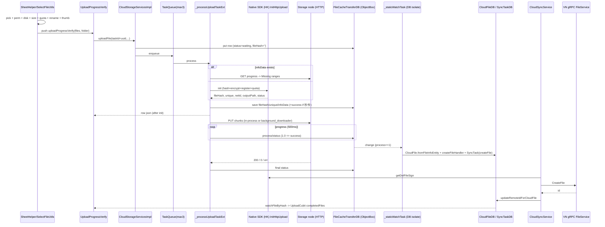

# Luồng upload file: từ lúc chọn file đến khi lưu vào CloudFile

> Ngày ghi: 2026-10-13 · Nhánh: `felix/cloud_upgrade/my_subscription`
> Nguồn: `/team` (explain) → `cs-explainer`. Chỉ đọc code, chưa chạy thử.
> Viết tắt: `CS` = `lib/features/cloud_storage`, `MB` = `lib/module_bridge`.
> Số dòng `file:line` đúng tại thời điểm ghi và có thể lệch khi code thay đổi.

## Tóm tắt

- **Upload không đi qua use case nào ở domain.** Widget `UploadProgressVerify` (ở `shared/widgets`) gọi thẳng `CloudStorageServices.uploadFile`.
- **Hai backend chạy nối tiếp, không có chuyện chọn một trong hai:**
  - **HK BE** (native SDK + HTTP) đẩy dữ liệu file lên storage node.
  - **VN BE** (gRPC `FileService/CreateFile`) tạo bản ghi file để quản lý thư mục.
- **Không có đoạn code nào tạo `CloudFile` ngay sau khi server trả 200.** Nó được tạo gián tiếp:
  1. Watcher ObjectBox `FileCacheTransferDB._staticWatchTask` chạy trong DB isolate, theo dõi bảng transfer.
  2. Thấy dòng nào có `process == 1`, watcher tạo `CloudFile` và ghi `SyncTask(createFile)` cùng lúc.
  3. `CloudSyncService` gọi VN gRPC `CreateFile`, rồi ghi `remoteId` vào `CloudFile`.

## A. Các điểm bắt đầu (chọn file)

1. Bấm nút "+" → `PageBasicWidget._onAddButtonTap` → `CloudStorageSheetHelper.showAddOptionsSheet`
   - [page_basic_widget.dart:140-156](../../../lib/features/cloud_storage/shared/widgets/page_basic_widget.dart#L140-L156)
   - [sheet_helper.dart:554](../../../lib/features/cloud_storage/shared/utils/sheet_helper.dart#L554)
2. Sheet chỉ có `onUploadFile`, `onUploadFromAlbum`, `onEncryptedFile`, `onHashDownload`, `onAddNewFolder`. **Không có lựa chọn camera.** Xem [add_options_view_model.dart:4-8](../../../lib/features/cloud_storage/shared/widgets/bottom_sheet/add_options/add_options_view_model.dart#L4-L8).
   - **Tài liệu (FilePicker):** [sheet_helper.dart:627-668](../../../lib/features/cloud_storage/shared/utils/sheet_helper.dart#L627-L668) → `SelectFileUtils.uploadFiles` ([select_file_utils.dart:132](../../../lib/features/cloud_storage/shared/utils/select_file_utils.dart#L132)).
   - **Album ảnh/video:** dùng `TbMediaPickerUtils.pickMediaWithSocialFi`, giới hạn kích thước = `storageSingleFileSize`. Đi từ [sheet_helper.dart:669-698](../../../lib/features/cloud_storage/shared/utils/sheet_helper.dart#L669-L698) → `SelectFileUtils.uploadAlbum` ([select_file_utils.dart:248-278](../../../lib/features/cloud_storage/shared/utils/select_file_utils.dart#L248-L278)).
   - **Két mã hoá:** [sheet_helper.dart:699-717](../../../lib/features/cloud_storage/shared/utils/sheet_helper.dart#L699-L717). Thư mục đích lấy từ `CloudFolderDB.getFolderEncrypted()`.
3. Chọn thêm file từ sheet preview: [preview_before_upload.dart:39-63](../../../lib/features/cloud_storage/shared/widgets/preview_before_upload.dart#L39-L63).
4. Đi vào từ module khác qua transponder:
   - **`uploadFileHttp`** → `CloudStorageServices.uploadFile`, dùng chung pipeline bên dưới. Xem [cloud_storage_transponder_impl.dart:441-479](../../../lib/features/cloud_storage/transponder/cloud_storage_transponder_impl.dart#L441-L479). Socialfi gọi hàm này ở `social_media_storage_service_http_impl.dart:112`.
   - **IM "lưu vào cloud" bằng hash** (`saveFilesToCloudStorage`): **không upload dữ liệu.**
     - Code: [cloud_storage_transponder_impl.dart:1082-1181](../../../lib/features/cloud_storage/transponder/cloud_storage_transponder_impl.dart#L1082-L1181).
     - Gọi `httpSaveFileToLocal` (HK native `HttpSaveFileHandler`).
     - Sau đó tạo `CloudFile` trực tiếp bằng `CloudFileDB.createFile(CloudFile.fromFileInfoEntity(...))` ở `:1140-1145`.
     - Cuối cùng ghi một dòng transfer với `process=1`.
   - **Socialfi chia sẻ bài viết** (`transferMediaToCloudStorage`): đi qua `TransferMediaRepositoryImpl` ([transfer_media_repository_impl.dart:26-160](../../../lib/features/cloud_storage/data/repository/transfers/transfer_media_repository_impl.dart#L26-L160)). Thứ tự gọi:
     1. native `transferFileToCloud`
     2. `getDelFileSign`
     3. VN gRPC `createFile` (gọi trực tiếp)
     4. `storeCloudFileDB`

## B. Kiểm tra ở tầng UI (`SelectFileUtils`)

5. Quyền truy cập bộ nhớ: [select_file_utils.dart:518-532](../../../lib/features/cloud_storage/shared/utils/select_file_utils.dart#L518-L532).
6. Dung lượng trống của máy: `DiskSpaceUtils().canUploadFiles`, ở [:177-197](../../../lib/features/cloud_storage/shared/utils/select_file_utils.dart#L177-L197) (luồng album ở `:319-340`).
7. Giới hạn kích thước mỗi file: `checkFileErrorLimitCloudStorage` ([:540-696](../../../lib/features/cloud_storage/shared/utils/select_file_utils.dart#L540-L696)). Chọn 1 file thì hiện toast; chọn nhiều file thì hiện dialog và loại các file quá lớn.
8. Quota cloud, **có tính cả các file đang chờ upload:**
   - `_canUploadOrShowSheet` → `StorageLimitGuard.canUploadOrShowSheet` ([storage_limit_guard.dart:194-214](../../../lib/features/cloud_storage/shared/utils/storage_limit_guard.dart#L194-L214)).
   - Điều kiện: `freeSpace - (useSpace + pendingUploadSize) >= uploadBytes`.
   - `pendingUploadSize` = các dòng `waiting` chưa có `infoData` ([file_cache_transfer_db.dart:435-460](../../../lib/features/cloud_storage/data/db/file_cache_transfer_db.dart#L435-L460)).
9. Trùng tên: `renameDuplicateFile` đổi thành `name(1).ext`. Hàm so với các file trong folder và cả các transfer đang chạy ([:422-514](../../../lib/features/cloud_storage/shared/utils/select_file_utils.dart#L422-L514)). `PreviewBeforeUpload.initState` gọi lại hàm này với folder đích.
10. Tạo thumbnail và lấy width/height/duration bằng `_genThumb` ([:372-420](../../../lib/features/cloud_storage/shared/utils/select_file_utils.dart#L372-L420)).
11. Chọn thư mục đích: `_handleConfirmSelectFolder` ([sheet_helper.dart:990-1069](../../../lib/features/cloud_storage/shared/utils/sheet_helper.dart#L990-L1069)).
    1. Interceptor `CloudSheetActionRegistry.checkBeforeUpload` chạy trước. Với két mã hoá, nó kiểm tra PIN; sai PIN thì người dùng chọn lại thư mục.
    2. Hiện sheet preview → `onUpload`. Nếu `requestPrivacy` bật thì mỗi file cần `pwd`.
    3. Push `CloudStorageRoute.uploadProgressVerify`.

## C. Bắt đầu upload (UI → service)

12. `UploadProgressVerify.initState` ([upload_progress_verify.dart:61-114](../../../lib/features/cloud_storage/shared/widgets/bottom_sheet/upload_files/upload_progress_verify.dart#L61-L114)):
    - tạo một `taskId = Uuid().v4()` cho mỗi file;
    - gọi `UploadCubit.init` và `listenDB`;
    - đặt `hash = taskId`;
    - watch `FileCacheTransferDB.watchByTaskIds`.
13. `Future.wait(_startUpload...)` → `getIt<CloudStorageServices>().uploadFile(..., isDisplayNotification: false)` ([:122-173](../../../lib/features/cloud_storage/shared/widgets/bottom_sheet/upload_files/upload_progress_verify.dart#L122-L173)).
14. `CloudStorageServicesImpl.uploadFile` → `_uploadFileExt` ([cloud_storage_services_impl.dart:372-417](../../../lib/features/cloud_storage/data/services/cloud_storage_services_impl.dart#L372-L417)).

## D. Điều phối upload (`cloud_storage_upload_ext.dart`)

15. `_uploadFileExt` ([cloud_storage_upload_ext.dart:4-152](../../../lib/features/cloud_storage/data/services/mixins/cloud_storage_upload_ext.dart#L4-L152)):
    - **Tìm dòng cũ theo taskId** (trường hợp resume hoặc upload lại). Nếu có thì khôi phục thông tin và chuyển failed/pause → waiting.
    - **Đọc `CloudFolder`:** `space = folder.space ?? normal`; `isEncrypt = (space == encrypt)`.
    - **Tạo bản ghi chờ:** một `FileCacheTransferEntity` mới với `fileHash: ''`, `process: 0`, `status: waiting`, `direction: upload`. Kèm theo path, parentId, folderId (remoteId), thumb, `isDisplay` (false nếu từ socialFi), size, pwd, isCrypt, space, name, ext, mime, resolution, platform, metaData.
    - **Đưa vào hàng đợi:** `uploadQueue.enqueue(taskId, UploadTaskParams)`.
16. `TaskQueue`:
    - dedup theo taskId ([task_queue.dart:120-137](../../../lib/features/cloud_storage/data/task_queue/task_queue.dart#L120-L137));
    - `maxConcurrentTasks: 3` (máy yếu chỉ 1), processor là `_processUploadTaskExt`;
    - `holdSlotUntil` giữ slot cho tới khi transfer chạy tách rời (detached) xong ([:166-183](../../../lib/features/cloud_storage/data/task_queue/task_queue.dart#L166-L183)).
17. `_processUploadTaskExt` ([cloud_storage_upload_ext.dart:324-781](../../../lib/features/cloud_storage/data/services/mixins/cloud_storage_upload_ext.dart#L324-L781)):
    - **a. Chọn node:** `baseUrl = getDomainCurrent()`, tức node nhanh nhất.
    - **b. Resume:** nếu dòng có `infoData` thì gọi `getUploadProgress` (HTTP GET) để lấy các đoạn `Missing`. Nếu không còn đoạn nào thiếu thì huỷ session cũ trên node ([:350-393](../../../lib/features/cloud_storage/data/services/mixins/cloud_storage_upload_ext.dart#L350-L393)).
    - **c. Init (HK BE)** ([:396-450](../../../lib/features/cloud_storage/data/services/mixins/cloud_storage_upload_ext.dart#L396-L450)):
      - socialFi → `getUploadSocialFiInitInfoAsync`; còn lại → `getUploadInitInfoAsync`.
      - Hai hàm được chạy tuần tự qua `_uploadInitInfoLock` ([cloud_storage_file_uploader.dart:226-302](../../../lib/features/cloud_storage/data/services/cloud_storage_file_uploader.dart#L226-L302)).
      - Hàm init gọi `CloudStorageUploadInitHandler` → FFI `InitHttpUploadWithCallBackV1` ([cloud_storage_upload_init_handler.dart:74-124](../../../lib/features/cloud_storage/data/native_handle/cloud_storage_upload_init_handler.dart#L74-L124)). Bước này băm (hash) file, mã hoá file, đăng ký upload với node và kiểm tra quota.
      - Kết quả: `fileHash`, `unique`, `domain`, `netId`, `outputPath` (bản đã mã hoá), `data.status`, `errorCode`.
    - **d. Lưu kết quả init** ([:462-496](../../../lib/features/cloud_storage/data/services/mixins/cloud_storage_upload_ext.dart#L462-L496)):
      - Ghi `fileHash`, `unique`, `infoData`, `code` vào dòng transfer.
      - Chuyển thumbnail và file vào cache theo tên fileHash.
      - Init trả null → failed.
    - **e. Upload tức thì (秒传)** khi `status == 1`: file đã có sẵn trên server, nên đặt process=1 + success, gọi `_notifyUploadCompleted` rồi return ([:502-516](../../../lib/features/cloud_storage/data/services/mixins/cloud_storage_upload_ext.dart#L502-L516)).
    - **f. Đẩy dữ liệu (chạy tách rời):** `_CloudStorageFileUploader.upload` → `CloudBackgroundTransferClient.upload` ([cloud_background_transfer_client.dart:813-989](../../../lib/features/cloud_storage/data/services/cloud_background_transfer_client.dart#L813-L989)).
      - URL tạo bằng `TransferApiUrlBuilder.buildUploadUrl`; file gửi đi là `outputPath`.
      - `UploadChunkSizer` chia chunk.
      - Nếu `_backgroundGuard.holdsProcess` thì gửi bằng `InProcessChunkUploader`; nếu không thì giao cho background_downloader.
    - **g. `onProgress`** (throttle 500ms), ở [:558-605](../../../lib/features/cloud_storage/data/services/mixins/cloud_storage_upload_ext.dart#L558-L605):
      - ghi `process` vào DB không await; khi `process >= 1.0` thì ghi **success**;
      - cập nhật Live Activity;
      - bỏ qua nếu taskId đang nằm trong `taskPending`.
    - **h. Kết quả cuối** ([:612-728](../../../lib/features/cloud_storage/data/services/mixins/cloud_storage_upload_ext.dart#L612-L728)):

      | Kết quả | Xử lý |
      |---|---|
      | 200 | process=1 + success, chuyển thumbnail, `updateFileByTaskId`, `_notifyUploadCompleted`, xoá file tạm |
      | 0 | pause |
      | mã khác | failed |
      | không có mạng | luôn failed |

    - **i. Trả kết quả và giữ slot:** dòng transfer được trả về cho caller ngay sau init. Phần đẩy dữ liệu chạy trong `_continuedProcessing.protectShared` (khi `isDisplay` bật), kèm `uploadQueue.holdSlotUntil`.

## E. Lưu vào CloudFile

18. `FileCacheTransferDB.initConfig()` đăng ký `_staticWatchTask` trên toàn bộ box. Nơi gọi: [cloud_storage_init_repository_impl.dart:128](../../../lib/features/cloud_storage/data/repository/cloud_storage_init_repository_impl.dart#L128); đăng ký ở [file_cache_transfer_db.dart:41-48](../../../lib/features/cloud_storage/data/db/file_cache_transfer_db.dart#L41-L48). `DbThreadPool.executeWatch` đăng ký ngay, không chờ có subscriber.
19. Mỗi khi box thay đổi ([file_cache_transfer_db.dart:74-129](../../../lib/features/cloud_storage/data/db/file_cache_transfer_db.dart#L74-L129)):
    - Lấy các dòng có `process >= 1`, có taskId và `!isDelete`.
    - Bỏ qua dòng download, và dòng đã có `CloudFile.hash == taskId` (kiểm tra bằng `CloudFileDB.getExistingHashes`).
    - Các dòng còn lại: `CloudFile.fromFileInfoEntity(f)` → `CloudFileDB.createFileHandler(store, object, parentId, metaData: f.toJson())`.
20. Mapper `CloudFile.fromFileInfoEntity` ([cloud_file.dart:278-309](../../../lib/database/tables/cloud_storage/cloud_file/cloud_file.dart#L278-L309)):
    - Lấy từ dòng transfer: `fileHash`, `name`, `ext`, `size`, `dir`, `isCrypt`, `pwd`, `thumb`, `platform`, `w/h/duration`, `metaData`, `unique`, `space`.
    - `hash = taskId`.
    - `createdAt = file.time`; `updatedAt = endTime`.
    - `path` chỉ có khi `process >= 1`.
    - **`remoteId = ''`**.
21. `createFileHandler` ([cloud_file_db.dart:238-329](../../../lib/features/cloud_storage/data/db/cloud_file_db.dart#L238-L329)):
    - Folder cha = folder theo `parentId`, không có thì dùng root. `dir ??= parent.path`.
    - Kế thừa trạng thái favorite của folder cha.
    - Upsert theo `hash` và thêm vào `parentFolder.files`.
    - **Ghi `SyncTaskEntity(hash, fileHash, payload = transfer json + cloudSyncType=createFile, parentRemoteId)`** qua `SyncTaskDB.putPublic`.
22. `CloudSyncService` ([cloud_sync_service.dart:60-224](../../../lib/features/cloud_storage/data/cloud_sync_service/cloud_sync_service.dart#L60-L224)) watch các task đang chờ → `_processTasks` → `_handleUpload`:
    1. Chuyển payload thành request: `FileCacheTransferEntity.fromJson(payload).toCreateFileRequest()`, với `folderId = parentRemoteId`.
    2. Bỏ qua nếu dòng local đã có `remoteId`.
    3. Gọi `FileServiceRepositoryImpl.createFile` ([file_service_repository_impl.dart:212-241](../../../lib/features/cloud_storage/data/_grpc/repositories/file_service_repository_impl.dart#L212-L241)): lấy `getDelFileSign` (HK native) trước, rồi gọi **VN gRPC `pb.FileService/CreateFile`**.
    4. Thành công → `updateRemoteIdForCloudFile(hash, remoteId)`, hàm này cũng đặt lại `createdAt`/`updatedAt` = now ([cloud_file_db.dart:1274-1296](../../../lib/features/cloud_storage/data/db/cloud_file_db.dart#L1274-L1296)). Sau đó xoá task.

## F. UI được cập nhật thế nào

23. `UploadCubit.listenDB` ([upload_cubit.dart:80-231](../../../lib/features/cloud_storage/pages/uploads_list_page/cubit/upload_cubit.dart#L80-L231)) theo dõi hai nguồn:
    - `watchByTaskIds` → tiến độ % và trạng thái;
    - `CloudFileDB.watchFileByHash(taskIds)` → hoàn tất khi đã có `CloudFile` mang fileHash; failed sau debounce 3s.
24. `UploadProgressVerify` báo "xong" khi `completedFiles.length == tasksCache.length`. Nghĩa là nó **chờ có `CloudFile`**, không chỉ chờ dòng transfer xong ([upload_progress_verify.dart:497-521](../../../lib/features/cloud_storage/shared/widgets/bottom_sheet/upload_files/upload_progress_verify.dart#L497-L521)).
25. Các màn My File, Home, Favorite watch `CloudFileDB.watchAllFiles` / `CloudFolderDB.watchAllFolders` (ví dụ [my_file_cubit.dart:94-140](../../../lib/features/cloud_storage/pages/my_file/cubit/my_file_cubit.dart#L94-L140)). File mới hiện ra ngay khi watcher ở bước 19 tạo bản ghi.
26. Dung lượng đã dùng: `_notifyUploadCompleted` → `UserSpaceRepository.notifyUsageChanged` → `UsedSpaceSyncWorker` (gộp nhiều lần thông báo thành một lần sync).
    - **Websocket cloud không có sự kiện "upload xong"**: `CloudStorageWsObserveManger` chỉ xử lý userSpace, limit, purchase, p2p.
    - Model `WsResDataUploadSinFileByCloudChannelModel` có tồn tại nhưng không được dùng.

## Sơ đồ

## Các class chính

| Class | Tầng | Vai trò | file:line |
|---|---|---|---|
| CloudStorageSheetHelper | shared/utils (UI) | Sheet thêm file, chọn folder, preview, push màn tiến độ | `CS/shared/utils/sheet_helper.dart:554, 990` |
| SelectFileUtils | shared/utils (UI) | Picker, kiểm tra, đổi tên trùng, tạo thumbnail | `CS/shared/utils/select_file_utils.dart:132, 248` |
| StorageLimitGuard | shared/utils | Kiểm tra quota phía client | `CS/shared/utils/storage_limit_guard.dart:194` |
| UploadProgressVerify | shared/widgets (UI) | Tạo taskId, gọi service | `CS/shared/widgets/bottom_sheet/upload_files/upload_progress_verify.dart:53-173` |
| UploadCubit | pages | Watch dòng transfer + CloudFile; retry/stop/delete | `CS/pages/uploads_list_page/cubit/upload_cubit.dart:19` |
| CloudStorageServicesImpl | data/services | API public, hàng đợi, listener mạng | `CS/data/services/cloud_storage_services_impl.dart:117` |
| _CloudStorageUploadExt | data/services/mixins | `_uploadFileExt`, `_processUploadTaskExt`, cancel/reUpload | `CS/data/services/mixins/cloud_storage_upload_ext.dart:3` |
| TaskQueue | data/task_queue | Song song + dedup + holdSlot | `CS/data/task_queue/task_queue.dart:120,166` |
| _CloudStorageFileUploader | data/services | Lock init, URL upload, progress/cancel | `CS/data/services/cloud_storage_file_uploader.dart:4` |
| CloudStorageUploadInitHandler | data/native_handle (HK) | FFI `InitHttpUploadWithCallBackV1` | `CS/data/native_handle/cloud_storage_upload_init_handler.dart:14` |
| CloudBackgroundTransferClient | data/services | Chia chunk, chọn in-process hay background_downloader | `CS/data/services/cloud_background_transfer_client.dart:66, 813` |
| FileCacheTransferEntity | ObjectBox | Bản ghi chờ / tiến độ của một transfer | `lib/database/tables/cloud_storage/file_cache_transfer/file_cache_transfer_entity.dart:16` |
| FileCacheTransferDB._staticWatchTask | data/db | **Tạo CloudFile** khi process==1 | `CS/data/db/file_cache_transfer_db.dart:74-129` |
| CloudFile / fromFileInfoEntity | ObjectBox | Bản ghi domain; mapper từ transfer sang file | `lib/database/tables/cloud_storage/cloud_file/cloud_file.dart:14, 278` |
| CloudFileDB.createFileHandler | data/db | Upsert CloudFile + ghi SyncTask createFile | `CS/data/db/cloud_file_db.dart:238` |
| CloudSyncService | data | Chạy SyncTask → VN CreateFile → remoteId | `CS/data/cloud_sync_service/cloud_sync_service.dart:171` |
| FileServiceRepositoryImpl.createFile | data/_grpc (VN) | delSign (HK) + gRPC CreateFile | `CS/data/_grpc/repositories/file_service_repository_impl.dart:212` |

## Lỗi và trường hợp đặc biệt

- **Init lỗi / hết quota phía server:**
  - Native handler trả `null` với mọi lỗi của SDK ([cloud_storage_upload_init_handler.dart:117-123](../../../lib/features/cloud_storage/data/native_handle/cloud_storage_upload_init_handler.dart#L117-L123)), và task bị đánh dấu failed.
  - Mã lỗi của SDK bị mất, nên UI không phân biệt được hết quota với lỗi khác.
  - Comment ở `cloud_storage_upload_ext.dart:504-506` có nhắc `Err = 3009 Insufficient space`, nhưng không thấy chỗ nào map mã này sang thông báo.
- **Init không có timeout** và giữ `_uploadInitInfoLock`. Nếu một init bị treo, mọi upload sau đó (cả cloud lẫn socialfi) bị chặn cho tới khi tắt app (có comment ở `cloud_storage_file_uploader.dart:220-225`).
- **Mất mạng:** `_pauseAllActiveTransfers` chuyển các upload waiting/uploading sang **failed**, trừ các task hệ điều hành đang chạy ([cloud_storage_services_impl.dart:634-677](../../../lib/features/cloud_storage/data/services/cloud_storage_services_impl.dart#L634-L677)).
- **Có mạng lại:** `_resumeInterruptedTransfers` chỉ upload lại các task failed/waiting/uploading có `process < 1`, bỏ qua socialFi, và kiểm tra bản ghi background_downloader trước ([:712-769](../../../lib/features/cloud_storage/data/services/cloud_storage_services_impl.dart#L712-L769)).
- **App bị kill giữa chừng:**
  - Lúc khởi động, `resetStatusAll` chuyển các dòng upload có `process < 1` (chưa failed) thành **pause** ([file_cache_transfer_db.dart:801-823](../../../lib/features/cloud_storage/data/db/file_cache_transfer_db.dart#L801-L823)).
  - Task pause không nằm trong danh sách tự resume. Theo code đã đọc, chúng chỉ chạy tiếp khi người dùng bấm Retry: `UploadCubit.reUploadIds` → `reUpByIds` → `_reUploadExt`, resume từ `infoData` + các đoạn `Missing`.
  - Chưa xác định được `CSNetworkUtils.listen` có phát sự kiện ban đầu lúc khởi động hay không.
- **Pause / cancel:** xử lý trong `_cancelUploadByTaskIdExt` ([cloud_storage_upload_ext.dart:154-194](../../../lib/features/cloud_storage/data/services/mixins/cloud_storage_upload_ext.dart#L154-L194)).
  - Có `isDelete`: xoá file tạm và huỷ session trên node.
  - Không có: chuyển sang pause.
  - `taskPending` ngăn `onProgress` ghi đè trạng thái.
- **Sync CreateFile:**
  - `retryCountMax = 1`, backoff 10s. Sau đó task nằm ở trạng thái error cho tới khi `resetErrorTasksRetry` chạy (lúc khởi động hoặc khi có mạng lại).
  - Nếu `delSign` rỗng, `createFile` trả null; trường hợp này tính là lỗi và được retry.

## Điểm nghi là bug (cần xác minh)

1. **`CloudFile` có thể được tạo trước khi node trả 200.**
   - `onProgress` đã ghi success khi `process >= 1.0` ([cloud_storage_upload_ext.dart:574-581](../../../lib/features/cloud_storage/data/services/mixins/cloud_storage_upload_ext.dart#L574-L581)).
   - Watcher chạy ngay lúc đó, tạo `CloudFile` và `SyncTask(createFile)`.
   - Nếu node sau đó trả lỗi, dòng transfer chuyển failed (`:683-686`), nhưng `CloudFile`/`SyncTask` không bị rollback.
2. **Thumbnail bị đổi tên hai lần.**
   - Sau init, thumbnail đã đổi thành `<fileHash>.jpeg` (`:472-477`).
   - Nhánh 200 gọi `_replaceFileThumbnail` lần nữa (`:628-634`). Vì file đích đã tồn tại, `_getUniqueFilePath` tạo ra `<fileHash>(1).jpeg`.
   - `CloudFile` tạo sớm (điểm 1) vẫn giữ đường dẫn cũ, và watcher không cập nhật lại hash đã tồn tại.
3. **Lệch đơn vị `createdAt`.**
   - `FileCacheTransferEntity.time` tính bằng **giây**, còn `CloudFile.createdAt` tính bằng ms.
   - Ngày chỉ đúng sau khi `updateRemoteIdForCloudFile` đặt lại = now (ms), tức là sau khi sync VN xong.
4. **Upload từ socialfi có lẽ cũng tạo `CloudFile` và gọi `CreateFile`.** Watcher không lọc theo `platform`/`isDisplay` ([file_cache_transfer_db.dart:89-121](../../../lib/features/cloud_storage/data/db/file_cache_transfer_db.dart#L89-L121)). Chưa rõ đây có phải chủ ý hay không.
5. **Mất danh sách đã chọn ở preview.**
   - Code: `widget.interaction.listFile = listFile ?? []` ([preview_before_upload.dart:50,60](../../../lib/features/cloud_storage/shared/widgets/preview_before_upload.dart#L50)).
   - Khi người dùng huỷ picker, hàm trả null, nên danh sách file đã chọn bị xoá.
6. **Mọi file bị coi là vượt giới hạn** khi `UserSpace` chưa có limit, do code dùng `storageSingleFileSize ?? 0` ([select_file_utils.dart:660](../../../lib/features/cloud_storage/shared/utils/select_file_utils.dart#L660)).
7. **Vi phạm phân tầng:** widget `UploadProgressVerify` gọi thẳng data service; `UploadCubit` phụ thuộc trực tiếp `data/db` và repository impl; không có use case. Các vi phạm này đã nằm trong `tool/layer_baseline.txt:336-341, 482`.
8. **Privacy space:** két mã hoá đặt `space = encrypt` → `isCrypt = true`. Privacy space cần `pwd` cho từng file khi `requestPrivacy` bật, nhưng mọi chỗ gọi đều truyền `requestPrivacy: false` (`sheet_helper.dart:664, 693`).

## Tài liệu cũ đã lỗi thời (`CS/docs/upload_flow.md`)

- Vẫn gọi module là `_new_cloud_storage`; tên hàm thiếu tiền tố `_` (ghi `uploadFileExt` thay vì `_uploadFileExt`).
- Ghi "ảnh/video bắt buộc có thumbnail, không có thì throw", nhưng code hiện tại không còn kiểm tra này.
- Sơ đồ ghi `UploadCubit` là nơi gọi `uploadFile`. Thực tế `UploadProgressVerify` gọi, còn `UploadCubit` chỉ observe.
- Ghi rằng file và thumbnail chỉ được chuyển vào cache khi nhận 200, nhưng code đã làm việc này ngay sau init.
- **Hoàn toàn không mô tả việc tạo `CloudFile`** (watcher, `SyncTask`, VN `CreateFile` / `remoteId`), cũng như `holdSlotUntil`, `_deleteUploadScratch` và cách chọn in-process hay background_downloader.
