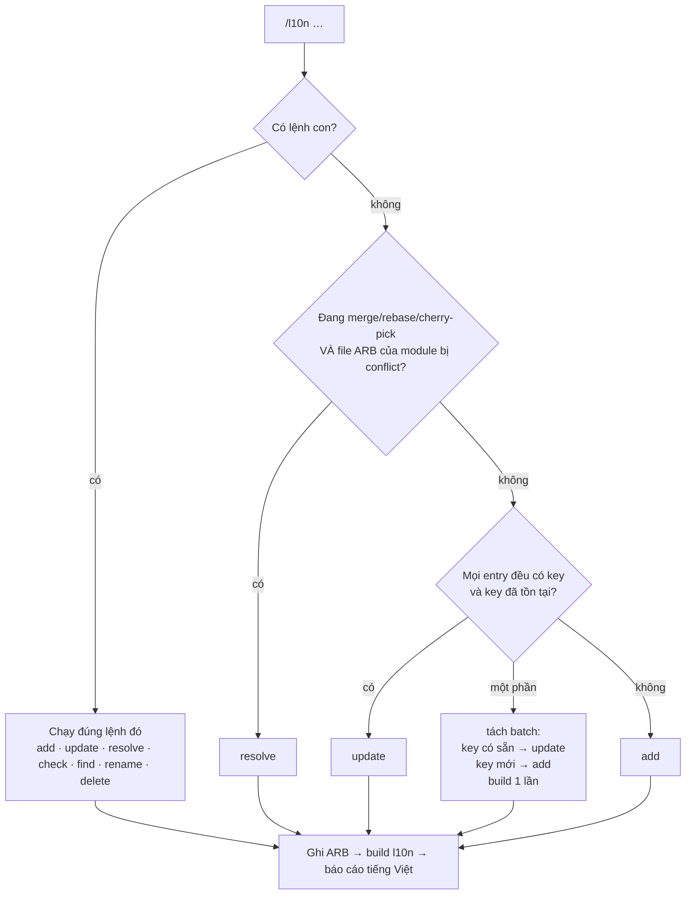

# /l10n — Hướng dẫn sử dụng

Một lệnh duy nhất cho mọi việc với chuỗi đa ngôn ngữ (file `.arb` trong
`lib/app/global/languages/modules/<module>/l10n/`): **thêm**, **sửa**, **resolve conflict**,
**kiểm tra**, **tìm**, **đổi tên**, **xoá** key.

```
/l10n [lệnh con] [cờ] <nội dung…>
```

Bỏ trống lệnh con thì skill **tự nhận diện** `add` / `update` / `resolve`. Dòng đầu tiên của kết
quả luôn cho biết lệnh nào đã chạy, ví dụ `▶ /l10n add (tự nhận diện) · module cloud`.

## Luồng xử lý



`check`, `find`, `rename`, `delete` **không bao giờ** được tự nhận diện — phải gõ rõ lệnh con.

## Bảng lệnh con

| Lệnh | Làm gì | Ghi file? |
|---|---|---|
| `add` | Thêm key mới vào **mọi** locale của module, tự sinh key nếu thiếu, dịch từ tiếng Anh | ARB |
| `update` | Ghi đè giá trị key **đã có**, đúng vị trí cũ; sửa luôn chỗ gọi khi placeholder đổi | ARB (+ code cloud/bridge) |
| `resolve` | Gỡ conflict ARB theo **từng key** khi merge/rebase/cherry-pick, rồi `git add` đúng các file ARB | ARB + stage |
| `check` | Báo cáo lỗi: JSON hỏng, conflict marker, thiếu key, key trùng, placeholder lệch, vượt trần độ rộng | không |
| `find` | Tìm key theo tên hoặc theo nội dung (mọi ngôn ngữ) | không |
| `rename` | Đổi tên key ở mọi locale + sửa chỗ gọi trong code | ARB + code |
| `delete` | Xoá key không còn dùng (key còn dùng → từ chối và liệt kê chỗ gọi) | ARB |

## Bảng cờ

| Cờ | Ý nghĩa | Dùng với | Mặc định |
|---|---|---|---|
| `-m`, `--module <tên[,tên…]\|all>` | Module đích. `add`/`update`/`rename`/`delete` chỉ nhận **1** module | tất cả | `cloud` |
| `-l`, `--locales <tag>` | Giới hạn nhóm ngôn ngữ. `add` vẫn ghi key vào mọi locale, nhóm ngoài `-l` nhận giá trị `en` và bị đánh dấu `⚠ chưa dịch` | add, update, check, find | mọi nhóm |
| `-n`, `--dry-run` | Chỉ xem trước, không ghi gì, không build, không stage | tất cả | tắt |
| `--no-build` | Không chạy `build_modular_l10n.dart` (skill nhắc bạn chạy tay) | add, update, resolve, rename, delete | tắt |
| `--strict-width` | Giá trị skill tự dịch mà vượt trần độ rộng → **hỏi bạn** thay vì ghi kèm ⚠ | add, update | tắt |
| `-f`, `--fill` | Dịch nốt các ngôn ngữ bạn **không** liệt kê | update | tắt |
| `--no-callsite` | Chỉ liệt kê chỗ gọi trong code, không sửa | update, rename | tắt |
| `-s`, `--single` | Tắt chế độ nhiều agent | resolve | bật nhiều agent |
| `-y`, `--yes` | Không hỏi xác nhận C1, giữ lựa chọn của script (vẫn in bảng C1) | resolve | tắt |
| `--include-social-fi` | Cho `resolve all` xử lý cả `social_fi` | resolve | tắt |
| `--in key\|value` | Chỉ tìm theo tên key / theo nội dung | find | cả hai |
| `--limit <n>` | Số dòng tối đa mỗi loại lỗi | check | 30 |

**Tag ngôn ngữ** (cho `-l`, dạng `tag=value`, dạng `key@tag`): `en`, `zh` (hoặc `cn`), `tw`, `hk`,
`ja`, `ko`, `id`, `lo`, `ru`, `hi`, `ur`. Mã đầy đủ (`en_US`, `zh_CN`, `zh_TW`, `zh_HK`) cũng được.
`en` = `en` + `en_US`, `zh` = `zh` + `zh_CN` (luôn giống nhau). Module nào không có file của tag đó
(ví dụ `im` không có `en_US`/`zh_CN` nhưng có `zh_HK`) thì skill báo lỗi cho entry đó.

## Ví dụ

### Tự nhận diện
```
/l10n Delete file                      → add (chưa có key)
/l10n deleteFile: "Remove file"        → update (deleteFile đã có)
/l10n -n Delete file                   → add, chỉ xem trước
/l10n deleteFile: "Remove file"
newKeyAbc: "Something new"             → batch hỗn hợp: deleteFile → update, newKeyAbc → add
/l10n                                  → resolve (nếu đang merge và ARB cloud bị conflict)
```

### add
```
/l10n add Delete file
/l10n add moveToFolder: "Move to folder"
/l10n add "{count} files selected"                      ← giữ {count}, tự thêm block @key
/l10n add renameOk: en="Rename" | zh="重命名" | tw="重新命名"  ← tự định nghĩa vài ngôn ngữ
/l10n add -m wallet Send token                          ← module wallet
/l10n add -l en,zh,tw Delete file                       ← chỉ dịch en/zh/tw, còn lại ⚠ chưa dịch
/l10n add
Delete file
来自发现
From the chat between {username1} and {username2}       ← nhiều chuỗi, mỗi dòng 1 entry
```

### update
```
/l10n update deleteFile: "Remove file"                  ← sửa mọi ngôn ngữ
/l10n update deleteFile@ja: "ファイル削除"               ← chỉ sửa tiếng Nhật
/l10n update -f
deleteFile@en: "Remove file"
deleteFile@zh: "移除文件"                                ← en, zh nguyên văn; các ngôn ngữ khác dịch nốt
/l10n update -l ja,ko deleteFile: "Remove file"         ← chỉ ghi lại ja và ko
/l10n update --no-callsite filesSelected: "{count} files of {total}"
```

### resolve
```
/l10n resolve                 ← module cloud
/l10n resolve im              ← module khác
/l10n resolve cloud,wallet    ← nhiều module
/l10n resolve all             ← mọi module đang conflict (social_fi sẽ hỏi lại)
/l10n resolve -s              ← một agent làm hết
/l10n resolve -n              ← chỉ xem report
/l10n resolve -y              ← không hỏi xác nhận C1
```

### check
```
/l10n check                   ← module cloud
/l10n check -m all            ← mọi module (trừ social_fi)
/l10n check -m im -l zh,tw,hk
```

### find
```
/l10n find folder
/l10n find -m all 回收站
/l10n find --in key upload
```

### rename
```
/l10n rename deleteFile removeFile
/l10n rename -n deleteFile removeFile
/l10n rename --no-callsite deleteFile removeFile
```

### delete
```
/l10n delete oldUnusedKey
/l10n delete -n keyA keyB keyC
```

## Quy tắc chính

1. **Text bạn gõ giữ NGUYÊN VĂN** cho ngôn ngữ của nó — không sửa chữ, không rút gọn, không dịch
   ngược. Dạng `tag=value` và `key@tag` cũng vậy.
2. **Tiếng Anh là chuẩn về NGHĨA**: nội dung bằng ngôn ngữ khác được quy về tiếng Anh trước, rồi các
   ngôn ngữ còn lại dịch **từ tiếng Anh** (một chặng).
3. **Độ dài = độ rộng hiển thị**, không phải số ký tự (đơn vị nửa em):

   | Loại ký tự | Rộng |
   |---|---|
   | Chữ Hán, Kana, Hangul, dấu câu full-width (`，。！？：；「」（）`) | **2** |
   | Latin, Cyrillic, chữ cái nền Lào / Devanagari / Ả Rập, chữ số, khoảng trắng, dấu câu ASCII | **1** |
   | Dấu phụ tiếng Lào (U+0EB1, U+0EB4–U+0EBC, U+0EC8–U+0ECD) | **0** |
   | Dấu phụ Devanagari (U+0900–U+0902, U+093A, U+093C, U+0941–U+0949, U+094D, U+0951–U+0957, U+0962–U+0963) | **0** |
   | Dấu phụ Ả Rập / Urdu (U+064B–U+065F, U+0670, U+06D6–U+06ED) | **0** |

   Bỏ `{placeholder}` ra khỏi phép đo. Ví dụ: `Delete file` → 11, `删除文件` → 8,
   `Удалить файл` → 12, `파일 삭제` → 9, `{count} files selected` → 15.
4. **Mốc `W`** = độ rộng chuỗi bạn gõ. Mọi giá trị skill tự sinh (kể cả tiếng Anh): mục tiêu ≤ `W`,
   trần cứng ≤ `max(1.15 × W, W + 4)`. Quá trần → rút gọn (bỏ từ khách sáo → thuật ngữ ngắn quen
   thuộc → tái dùng wording key anh em → bỏ chủ ngữ/tân ngữ UI đã rõ); không cắt giữa từ, không
   thêm `…`, không bỏ placeholder. Câu dài trong dialog (`W > 80`) chỉ ghi chú, không ép.
5. **Mọi locale luôn có cùng bộ key**; `en`/`en_US` và `zh`/`zh_CN` luôn giống nhau.
6. **Placeholder** giữ y hệt ở mọi ngôn ngữ, kèm block `@key` trong mọi file.
7. `add` chèn key mới vào **cuối** file; `update` ghi đè **đúng chỗ**; `rename` giữ nguyên vị trí.
8. Xong là skill tự chạy `dart run scripts/build_modular_l10n.dart` (trừ khi `--no-build` / `-n`).

## An toàn

- `social_fi` là module của team khác: chỉ ghi khi bạn gõ rõ `-m social_fi` **và** xác nhận khi
  được hỏi. `-m all` luôn bỏ qua `social_fi`.
- Code Dart chỉ được tự sửa trong `lib/features/cloud_storage` và `lib/module_bridge`; chỗ gọi ở nơi
  khác → skill liệt kê và hỏi trước. **Không bao giờ** sửa `lib/features/socialfi`.
- Không đụng `modules/new_cloud/` (đồ cũ, không build) và file generated.
- Không commit, không push, không `git merge --continue` / `git rebase --continue`. `resolve` chỉ
  `git add` đúng các file ARB nó đã ghi — bạn tự xem lại rồi chạy `git <mode> --continue`.

## Lưu ý

- State của `resolve` nằm ở `<git-dir>/l10n-resolve/`. Nếu còn phiên resolve dang dở từ skill cũ,
  hãy kết thúc hoặc huỷ nó trước khi dùng `/l10n resolve`.
- Muốn đưa file ARB về trạng thái conflict ban đầu:
  `dart .claude/skills/l10n/scripts/merge_arb.dart abort --restore`.
- Skill mới tạo/sửa giữa phiên có thể chưa hiện trong danh sách `/` cho đến khi **khởi động lại
  Claude Code**.
- Chi tiết từng lệnh: [add.md](./add.md) · [update.md](./update.md) · [resolve.md](./resolve.md) ·
  [check.md](./check.md) · [find.md](./find.md) · [rename.md](./rename.md) ·
  [delete.md](./delete.md).
