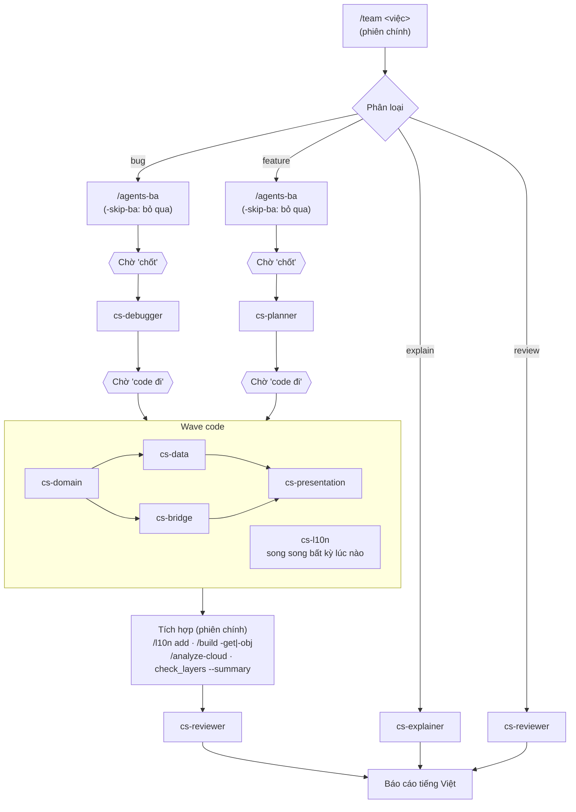

# /team — hướng dẫn dùng

`/team <việc>` là lệnh điều phối một "cây" gồm 9 subagent chuyên cho `lib/features/cloud_storage`
(CS) và `lib/module_bridge` (MB). Lệnh tự phân loại việc, giao cho đúng agent, và **dừng chờ
"code đi"** trước khi sửa bất kỳ file nào.

Với `feature` và `bug`, `/team` chạy **BA đầy đủ** (`/agents-ba`, dừng chờ **"chốt"**) rồi mới
lập kế hoạch. Thêm `-skip-ba` để bỏ bước BA với việc nhỏ hoặc đã rõ.

Figma và video tuân theo [.claude/_rule/media-access.md](../../_rule/media-access.md): **hỏi
trước từng lượt gọi Figma MCP**, hỏi trước khi xem video, kết quả được cache để không gọi lại.

Vì subagent của Claude Code không gọi được subagent khác, phiên chính (nơi bạn gõ `/team`) đóng vai
"trưởng nhóm": giao việc, chạy từng wave, kiểm tra quyền sở hữu file, chạy bước tích hợp và báo cáo.

## Sơ đồ cây



## Loại việc → chuỗi agent

| Loại | Chuỗi | Sửa file? |
|---|---|---|
| `explain` | `cs-explainer` → trả lời | Không |
| `review` | `cs-reviewer` → báo cáo phát hiện (muốn sửa → "code đi" → chạy như bug) | Không |
| `bug` | `/agents-ba` → **chờ "chốt"** → `cs-debugger` → kế hoạch sửa → **chờ "code đi"** → agent code theo lớp → tích hợp → `cs-reviewer` → báo cáo | Sau "code đi" |
| `feature` | `/agents-ba` → **chờ "chốt"** → `cs-planner` → kế hoạch wave → **chờ "code đi"** → `cs-domain` → (`cs-data` ∥ `cs-bridge`) → `cs-presentation` (+ `cs-l10n` song song) → tích hợp → `cs-reviewer` → báo cáo | Sau "code đi" |

Không chắc là loại nào thì `/team` sẽ hỏi lại bạn.

Thêm `-skip-ba` thì `bug` và `feature` bỏ bước `/agents-ba` và "chốt", đi thẳng vào
`cs-debugger` / `cs-planner`. Nếu việc có rule nghiệp vụ mới, API mới hoặc nhiều màn hình,
`/team` sẽ cảnh báo và hỏi lại một lần.

## Figma & video

- **Figma:** trước mỗi lượt gọi MCP, Claude hỏi `Gọi` / `Không — tôi gửi ảnh/mô tả` /
  `Không — bỏ qua`. Bước BA và lập kế hoạch chỉ gọi `get_screenshot`. `get_design_context` chỉ
  gọi ngay trước wave `cs-presentation`, và cũng hỏi trước. Kết quả cache ở
  `.claude/document/upgrade/docs/ba/<slug>.assets/figma/`. Các agent `cs-*` chỉ đọc cache, không
  gọi MCP. Số lượt đã dùng in ở báo cáo cuối.
- **Video:** hỏi `Cho xem` (tải về, cắt khung hình bằng ffmpeg) / `Không — tôi mô tả` /
  `Không — bỏ qua`.

## 9 agent

| Agent | Vai trò | Được sửa |
|---|---|---|
| `cs-planner` | Lập kế hoạch wave cho tính năng mới | — |
| `cs-debugger` | Truy bug qua các lớp, tìm nguyên nhân gốc, đề xuất sửa (`file:line`) | — |
| `cs-reviewer` | Review diff, chạy `dart analyze` + `check_layers --summary` | — |
| `cs-explainer` | Giải thích luồng / API / kiến trúc, trích `file:line` | — |
| `cs-domain` | Entities, interface repository, use case, `application/` | `CS/domain/**`, `CS/application/**`, `CS/shared/{enum,failures,typedef,constants}/` |
| `cs-data` | Repository impl, datasource, mapper, `_grpc` (BE VN), `native_handle` (BE HK) | `CS/data/**`, `CS/shared/{network,native}/`, `CS/shared/extensions/{_grpc,db}/`, `lib/database/tables/cloud_storage/**` (chỉ khi kế hoạch ghi rõ + bạn đồng ý) |
| `cs-bridge` | Interface giao tiếp giữa các feature | `MB/**` |
| `cs-presentation` | Màn hình, cubit, transponder impl, view model, widget, route | `CS/pages/**`, `CS/transponder/**`, `CS/model_view/**`, `CS/shared/{widgets,presentation,routes,utils,themes,mixin}/`, phần còn lại của `CS/shared/extensions/`, `CS/cloud_storage_config_feature.dart` |
| `cs-l10n` | Chuỗi trong 12 file ARB cloud | `lib/app/global/languages/modules/cloud/l10n/cloud_*.arb` |

Phạm vi sửa của các agent code **không chồng nhau**. Không agent nào được sửa
`lib/features/socialfi/**`, `CS/tool/**`, `layer_baseline.txt`, file sinh tự động.

Lưu ý:
- **Bridge mới** được làm qua 2 bước: `cs-bridge` viết interface trong `MB/`, sau đó
  `cs-presentation` viết `*TransponderImpl` trong `CS/transponder/`.
- **Chuỗi l10n:** các agent code không sửa ARB, chỉ trả về danh sách `key: English text`.
  `cs-l10n` chỉ được giao khi chuỗi đã biết ngay từ kế hoạch. Chuỗi phát sinh sau đó thì
  phiên chính gom lại và chạy `/l10n add` một lần.
- **Bước tích hợp** (`/l10n add`, `/build -get`, `/build -obj`, `/analyze-cloud`,
  `check_layers.dart --summary`) luôn do phiên chính chạy. Nếu có lỗi analyzer chặn build,
  phiên chính sửa bằng giá trị mặc định an toàn kèm `// TODO(cloud)` mà không hỏi lại.

## Ví dụ

```text
/team giải thích luồng upload file từ lúc chọn file đến khi lưu vào CloudFile
```
→ `explain` → `cs-explainer` → câu trả lời kèm các bước và `file:line`.

```text
/team review các thay đổi hiện tại trong cloud_storage và module_bridge
```
→ `review` → `cs-reviewer` → bảng phát hiện, kết quả analyze và layer check.

```text
/team bug: bỏ favorite một file trong trang Favorite xong, kéo refresh thì file vẫn hiện lại
```
→ `bug` → `/agents-ba` (trả lời câu hỏi, nói **"chốt"**) → `cs-debugger` → nguyên nhân gốc và
kế hoạch sửa → bạn nói **"code đi"** → agent code theo lớp → tích hợp → `cs-reviewer` → báo cáo.

```text
/team -skip-ba bug: nút Gia hạn bị lệch 4px trên màn My Subscription
```
→ `bug` nhỏ, bỏ BA → `cs-debugger` → kế hoạch sửa → **"code đi"** → …

```text
/team thêm tính năng đổi tên thư mục trong trang Favorite (API gRPC RenameFavoriteFolder, BE VN)
```
→ `feature` → `/agents-ba` → **"chốt"** → `cs-planner` → kế hoạch W1 `cs-domain` → W2 `cs-data` → W3 `cs-presentation`
(+ `cs-l10n`) → bạn nói **"code đi"** → chạy các wave → tích hợp → `cs-reviewer` → báo cáo.

## So với các skill khác

| Khi nào | Dùng |
|---|---|
| Có ticket từ nguồn ngoài (ZenTao, file spec, link…), cần gom nguồn vào ticket rồi BA → plan → code, kèm báo cáo gửi lại người giao | `/task` |
| Yêu cầu gõ trực tiếp, cần BA rồi giao cho agent chuyên theo lớp (`cs-planner` / `cs-debugger` → `cs-domain`…) | `/team` (BA mặc định với feature/bug) |
| Việc nhỏ đã rõ, hoặc chỉ cần giải thích / review | `/team -skip-ba`, `/team giải thích…`, `/team review…` |
| Yêu cầu đã rõ trong hội thoại, chỉ cần bảng phân công agent | `/agents-plan` |

## Ghi chú
- Không commit, push, hay tạo branch/MR.
- File agent nằm ở `.claude/agents/cs-*.md`. **Không** đặt file `.md` nào khác vào thư mục đó,
  vì Claude Code coi mọi `.md` ở đó là agent.
- Mới thêm agent hoặc skill thì có thể phải mở lại phiên Claude Code để `/team` và `/agents`
  hiện ra.
